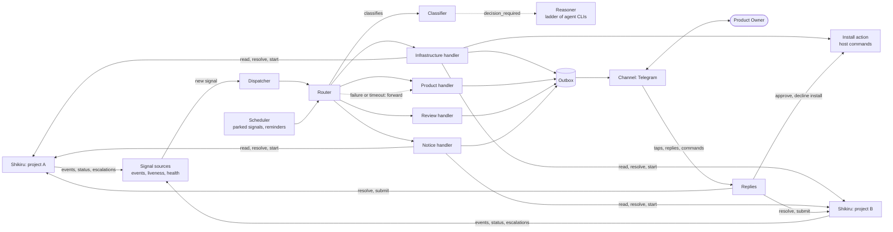

# Shikiri-yaku: design

This document describes what the Operator does and how it is built. Setup, configuration, chat use and recovery steps are in the [README](../README.md). Working rules for the people and agents who change the code are in [AGENTS.md](../AGENTS.md).

## Purpose

Shikiru runs the development: one engine per repository, with Leader and Implementer agents, review and integration. When it cannot continue on its own it raises an **escalation** and waits for a person. Today that person watches tmux.

Shikiri-yaku (the **Operator**) takes that seat. It watches the escalations and a few other signals of every Shikiru project of a product, sorts each one into a **category**, and hands it to the **handler** for that category. A handler either resolves the escalation itself or forwards it to the Product Owner (PO) through a chat channel (Telegram first). The PO answers with a button or a short reply, and the Operator applies the answer in Shikiru.

The first release has four handlers:

* **Product**: forwards the escalation to the PO.
* **Infrastructure**: retries, waits for quota resets, restarts engines and, after the PO approves the exact command, installs a missing tool. Whatever it cannot fix it forwards.
* **Review**: sends the PO the link of a pull request that waits for review (Shikiru's pull-request integration mode).
* **Notice**: tells the PO that a task is done, or that the Operator itself has a problem.

The Operator exists to remove idle time: work waiting for a person who is not watching, and problems a person would have fixed with one command. The `stats` command prints the figures of the journal that show it.

## Principles

1. **Shikiru is the source of truth.** Tasks, escalations, their state and history live in Shikiru and are read and changed through its MCP server only (plus the `start` and `doctor` commands of its CLI). The Operator keeps no copy of the backlog and never touches Shikiru's database.
2. **A small fixed core, growth by extension.** Watching, sorting, routing, replying and journaling are the core. Categories, handlers, actions, Reasoner jobs and channels are extensions, wired in one place.
3. **Every route ends at the PO.** An unknown signal, an unsure classification, a failed or exhausted handler, or a model that is down all mean *forward to the PO*. Nothing is dropped, and a new extension can never do worse than plain forwarding.
4. **Agents propose, code acts.** The Reasoner may look things up with read-only tools but cannot change anything, and returns typed data. Code validates it, builds every host command from fixed recipes, and runs only what the PO has approved. A model never writes a shell command.
5. **Journal before acting, check after.** Every effect (a Shikiru command, a host command, a message) is recorded before it happens, and success is checked by observation, not assumed.
6. **No model is needed to stay useful.** Watching, rule-based sorting, forwarding and replies are plain code. With every model down the Operator still forwards everything.
7. **Nothing of the Operator is stored in the managed repositories,** just as Shikiru keeps its own state out of them.
8. **If the Operator needs something Shikiru does not offer, the gap is fixed in Shikiru,** not worked around in the Operator. The structured escalation view is the one such dependency ([Shikiru interface](#shikiru-interface)).
9. **Only what is described is built.** A case this document does not describe has no code.

## Architecture

### Processing flow



Every module reads and writes the journal ([Journal](#journal)); it is left out of the picture. The Reasoner is used only by the Classifier: its verdict is stored with the signal, and the Install action reads it from there.

One Python process with one asyncio loop, one SQLite journal, one TOML config and the OS service manager. Modules, not services. The reason is that watching, pending questions and message delivery must keep working when an agent runs out of quota, changes or crashes, so they cannot live in an agent session.

One Operator instance serves one product, with its own instance directory, `journal.db`, chat bot and service unit. There is no registry of products; several products mean several instances. The layout, the configuration, the command line and the service setup are documented in the [README](../README.md).

### Modules and dependencies

| Module | Responsibility | Uses a model? |
|---|---|---|
| **Signal sources** (`app/event_source.py`, `liveness_source.py`, `health_source.py`) | Read each project's events over one supervised `shikiru --project P mcp` link with a durable cursor, check engine liveness and report the Operator's own link and Reasoner failures. They only produce signals ([Signals and sources](#signals-and-sources)) | No |
| **Dispatcher** (`app/dispatcher.py`) | Submits `new` signals to the Router, oldest first; after a crash it puts `handling` signals back to `new` | No |
| **Classifier** (`domain/rule_classifier.py`, `app/assessor.py`) | Assigns a category: an ordered rule table, and for `decision_required` the Reasoner's verdict ([Classification](#classification)) | Only for `decision_required` |
| **Router** (`app/router.py`) | Classifies a signal, runs its handler with a timeout and turns every failure into a forward | No |
| **Scheduler** (`app/scheduler.py`) | Wakes parked signals when they are due and sends the reminders of open forwards | No |
| **Handlers** (`extensions/*`) | Product, infrastructure, review and notice; each returns an outcome ([Handlers](#handlers)) | Infrastructure: through the Reasoner's verdict |
| **Loop guard** (`app/loop_guard.py`) | Limits automatic actions per cause, from the journal | No |
| **Install action** (`extensions/infrastructure/install.py`, `app/install_executor.py`) | Host facts, command building, approval, running and checking ([Installing a missing tool](#installing-a-missing-tool)) | No |
| **Reasoner** (`app/reasoner_ladder.py`, `adapters/reasoner_cli.py`) | One job, `assess_blocker`, behind an interface; agent CLIs tried in a ladder ([Reasoner](#reasoner)) | Yes |
| **Channel** (`ports.Channel`, `adapters/telegram*.py`) | Sends, edits and deletes the PO's messages and polls the PO's updates ([PO channel](#po-channel)) | No |
| **Outbox** (`journal/outbox.py`, `app/outbox_sender.py`) | Stores every message before it is sent and delivers it through the Channel | No |
| **Replies** (`app/replies.py`, `app/inbound_service.py`) | Applies taps, replies and commands through the message they belong to: Shikiru commands, install approvals and goals | No |
| **Reconcilers** (`app/reconciler.py`, `install_reconciler.py`, `start_reconciler.py`) | Settle the effects a restart left uncertain, by observing Shikiru and the host ([Restarts and recovery](#restarts-and-recovery)) | No |
| **Journal** (`journal/`) | SQLite store ([Journal](#journal)) | No |

**Dependencies** point inward: `domain` imports nothing else of the project, `app` and `extensions` import `domain` and `ports`, adapters implement ports, and only `bootstrap.py` builds concrete objects. The import-linter contracts in `pyproject.toml` enforce this. Every class receives its dependencies through its constructor, so tests replace them with fakes.

### Composition and extension registration

`bootstrap.compose()` is the composition root. It reads the settings and builds one Shikiru client per component, the Reasoner if one is configured, the journal, the Channel and Outbox, and the classifier, Router, Dispatcher, Scheduler, inbound poller and reconcilers. It returns the jobs to serve and a `recover()` step that runs before serving.

An **extension** is one folder under `extensions/` (`infrastructure/`, `review/`, `notice/`, `product/`) with its rules, its handler and the handler's actions. `registered_extensions()` lists them in classification order: infrastructure, review, notice, then product, whose catch-all rule comes last. The Router's handler table is built from the same list. Rules are checked in that order and the first match wins; startup fails if two extensions claim the same reason.

A new category, handler, action, source, Reasoner job, classifier or channel is written and registered in `bootstrap.py`. The Router, the classifier and the journal never switch on a specific category or kind.

## Signals and sources

A **signal** is one thing that may need attention. All signals have the same shape, so classification and routing do not care where they came from: a stable `id`, the `project`, the `task_id` and `escalation_id` when known, a `kind` (`escalation`, `engine_down`, `engine_fault`, `task_done`, `pr_review` or `health`), the `reason` (Shikiru's escalation reason, or the stop reason of an engine) and a `text` for the message.

**Identity.** The id has the pattern `<project>:<kind>:<source id>`, where the source id comes from the escalation, the event or, for `health`, the failure and its start. It is the same after a restart, so duplicates are impossible.

**Event source.** One reader per project long-polls Shikiru's events. An escalation, a finished task, a pull request ready for review and an engine stopped by a fault each raise a signal. A pull request's signal closes when it is withdrawn, when its task is done (merged) or when Shikiru escalates `pr_closed`. `escalation_resolved` closes the signal of that escalation, whoever resolved it ([Commands to Shikiru](#commands-to-shikiru)). A `task_cancelled` creates no signal; it closes the open signals of its task. Lifecycle events only update the project's state. Shikiru retries engine faults itself, so only a fault stop raises a signal. The cursor and the journal rows it causes commit in one transaction, so a crash replays at most one batch.

**First sync.** A project seen for the first time has its history read once, and only its current state is kept: its lifecycle, the escalations still open and the pull requests still waiting. History is never replayed as signals, and a clean stop found in it counts as respected.

**Liveness.** A crashed engine raises no escalation, so the liveness source checks `status.engine_up` every minute. An engine that is down after it was started raises `engine_down`; one that was never started is only shown in `/status`. A clean stop records no reason, so a deliberate stop and a host shutdown look alike, and the Operator tells them apart by time. A stop observed while the Operator runs is **respected** once the engine stays down for `stop_grace_min`: it is saved and never triggers a restart, also after the Operator restarts. A clean stop that happened before this run and was never respected is treated as `engine_down` at once. So no engine is restarted against the PO's will, and none is left down after a reboot.

**Health.** The Operator's own problems are signals too: a project's MCP link that stays unreachable for `link_unreachable_min`, and the Reasoner when its whole ladder fails ([Reasoner](#reasoner)). A `health` signal opens once on the failure, closes on recovery, and is not repeated while it stays open.

PO messages are not signals. They go through the [PO channel](#po-channel).

## Classification

A **category** names who should deal with a signal. Categories are an open set; the first release has four:

| Category | Meaning | Handler |
|---|---|---|
| `product` | Needs the PO: a product choice, a delivery decision, or anything unsure | Product |
| `infrastructure` | A problem of the machine, the agents or the workflow that code may fix | Infrastructure |
| `review` | Work waits for the PO's review | Review |
| `notice` | Information, nothing to decide | Notice |

**The Classifier is an interface:** `async classify(signal) → Classification(category, source, note)`. The first implementation, `RuleClassifier`, applies the rules that the registered extensions contribute, in registration order. A decision model can replace or precede it later by changing only the composition root.

**Rules.** Every signal except `decision_required` is sorted by its typed `reason` or `kind`, at no token cost, so a reason Shikiru adds later falls to the catch-all. In short: agent, integration, quota and engine problems go to infrastructure; a pull request ready for review goes to review; finished work and health go to notice; everything else, including reasons that have no action yet, goes to product.

**`decision_required`.** Without a configured Reasoner this is always `product`. With one, the question waits for the verdict at most `reasoner.timeout_s`. Code collects host facts first (OS, which package managers exist, PATH). The Reasoner's `assess_blocker` job ([Reasoner](#reasoner)) reads the reason, the question, the agent's options and these facts. Its verdict is `host_tool` (a program is missing on the machine), `project_dependency` (a library the project itself must declare) or `other`. On a model failure, a timeout, an invalid answer or the verdict `other`, the category is `product`, and the model's one-line suggestion becomes a note on the message, marked as model-written; when the Reasoner failed, the note says so. A `project_dependency` is never installed on the host: it would work here and fail everywhere else, and the fix is a change to the project's dependency file, which is the agent's job. The PO sees the suggestion, for example "add it to `<file>`". The Operator never writes into a repository. A wrong verdict is cheap by design: the infrastructure path forwards whatever it cannot fix, and it never acts on the host without the PO's approval. Verdicts are logged with the signal so misroutes can be reviewed by hand.

## Handlers

A handler takes one signal and returns one **outcome**:

```python
class Handler(Protocol):
    async def handle(self, signal: Signal) -> Outcome: ...

type Outcome = Resolved | Forward | WaitUntil | Informed | Notified
```

* `Resolved(note)`: the handler applied a fix in Shikiru; the signal closes.
* `Forward(note, standing)`: the signal goes to the PO through the Product handler, with the note saying what was tried and why it stopped. `standing` marks a message about something that stays true until it is fixed, so *Stop reminders* applies to it. The handler decides this, not the kind of the signal.
* `WaitUntil(wake_at, note)`: the signal is parked and dispatched to the same handler at `wake_at`. The handler records what it is waiting for as an op of kind `wait`, so on the second call it finds that op due and performs the follow-up action instead of waiting again.
* `Informed(note)`: the handler sent the PO a message that only informs; the signal closes when it is sent. Such a message has no button, so it never gets reminders.
* `Notified(note)`: the handler sent the PO its own message about the signal (the Review handler's pull-request message). The signal stays open and unanswered like a forward, so reminders apply, but the Product message is not sent.

Each handler gets what it needs through its constructor (the Channel, the journal and its actions), so its dependencies are visible and fakeable. A handler that does several things, as the Infrastructure handler does, receives them as **actions**: small objects `Action.run(signal) → Outcome`, each built with its own dependencies and naming the reasons it covers. A new action is added without editing the handler, and tests use fake actions.

**The Router guarantees the fallback.** An exception, a timeout or an unknown category becomes `Forward`. Signals are handled as independent asyncio tasks, and the only shared resources are the host lock and the Reasoner (at most `reasoner.max_parallel` calls at once).

**Loop guard.** An automatic action is journaled with its project, its cause (for a retry, the task and the reason) and its action before it runs, and a handler asks the guard before acting. The budgets are settings ([configuration reference](../README.md#configuration-reference)). A spent budget becomes `Forward` with the history, so a fix that does not hold never loops.

### Product handler

It forwards. The message is a template over Shikiru's fields, so it needs no model. The question and the agent's options, with their consequences and the recommended one, come from Shikiru's structured escalation view ([Shikiru interface](#shikiru-interface)). An escalation without agent options offers Shikiru's own resolutions (`retry`, `accept`, `cancel`), each only where the escalation allows it.

* **Answers.** An option resolves the escalation with `answer`, with the option's label and consequences as text. An option that needs input asks for a reply first, and a free-text reply to the message is sent as the answer. `accept` and `cancel` ask for a confirming tap.
* **Information.** A signal without an escalation is shown as information. A message that only informs closes when it is sent. A message about something that stays true until it is fixed carries *Stop reminders*, which silences its reminders and leaves the signal open.
* **Silence never approves anything.**

### Infrastructure handler

The handler picks an action by the signal's reason or kind:

* **Retry**: `agent_error`, `agent_stuck`, `agent_protocol`, `integration_conflict` and `integration_blocked` are given back to Shikiru with `resolve_escalation(retry)` at once; Shikiru has already backed off before escalating. The loop guard forwards a second escalation of the same cause.
* **Wait**: `quota_exhausted` and `ladder_exhausted` are parked until the latest reset of the windows that are used up, plus a margin, and then retried. A signal with no known reset, or one beyond `quota_wait_max_h`, is forwarded.
* **Restart**: `engine_down` and `engine_fault` start the engine with `shikiru start` and confirm `status.engine_up`; Shikiru resumes its tasks itself. A failed or repeated start is forwarded with the failed checks of `shikiru doctor`. `engine_error` gets the same restart if the engine is down, and then its escalation is retried.
* **Install**: `decision_required` with the verdict `host_tool` goes to the install action ([Installing a missing tool](#installing-a-missing-tool)); any failure is forwarded.

The Operator uses `resolve_escalation(retry)`, never `retry_task`. The first is rejected by Shikiru if the escalation is already resolved; the second interrupts and requeues whatever the task is doing, so repeating it after a restart would be harmful. Product code is never repaired by the Operator; retrying gives the work back to Shikiru's agents.

### Installing a missing tool

The Operator runs as the PO's user, so a command the PO approved is the same as one the PO ran. The Reasoner only points at *what* is missing. **Code builds the command.**

```
decision_required, verdict host_tool
  → validate        code: tool, manager and package fields
  → check before    code: command -v <tool>
  → approval        PO taps Install or Decline
  → run             code, under the host lock
  → check after     code: command -v <tool>
  → resolve         answer "Installed <tool> ..." to the Leader
```

1. **Validate.** The Reasoner's `tool`, `manager` and `package` must match strict name patterns, the manager must be on an allow-list and exist on the host, and the pair must have a recipe. Anything else is forwarded. A recipe is a fixed argument list, never a shell string; the supported managers are in the [README](../README.md#install-approval). A system package manager or `sudo` is never run, so the signal is forwarded with the suggestion instead.
2. **Is it really missing?** Code runs `command -v <tool>` in the user's login shell. If the tool is found, nothing is installed: the agent could not see a tool that exists, so the signal is forwarded with the path found.
3. **The PO approves the exact command.** The message shows the tool, the model's reason (marked as model-written), the command as code built it and its effect. The argument list is stored before the message is sent, and what runs is that stored list, never re-derived. **Decline** forwards the original escalation. The approval is a conditional state change (`intended → approved`), so two taps cannot start two installs, and it is void after `approval_expiry_h` (24 hours by default) or once the escalation is resolved elsewhere.
4. **It runs like the PO would run it:** in the login shell, outside every repository, under the host lock, with a timeout after which the whole process group is killed. A password prompt fails fast.
5. **Success means the check passes,** not exit code 0. The output goes to a file in the instance directory, and on failure its tail goes to the PO with the forward.
6. **Resolve.** `resolve_escalation(answer)` tells the Leader that the tool is installed and where it is. The resolve uses `answer`, so no retry is offered for it.
7. **Journaled before it runs.** An issued install is never repeated blindly: after a restart the check decides, and if the tool is still missing the PO is asked again.

The Reasoner never writes a command; free-form commands are not part of this design. The recipe allow-list is in `domain/recipes.py`, the checks and facts in `app/tool_check.py` and `app/host_facts.py`, and the process runner in `adapters/commands.py`.

### Review handler

Shikiru's pull-request integration mode opens a pull request for a finished task and keeps the task *integrating* until the PR is merged or closed. Nobody is asked, so there is no escalation; the PO simply has to look. The handler sends one message with the task title, the commit count, an *Open PR* link button and *Stop reminders*. The Operator does not merge, comment or review.

* **Closing.** The signal closes when the task is done (merged), when the PR is withdrawn, or when Shikiru escalates `pr_closed`; the message is then edited to its final state. *Stop reminders* only silences the reminders.
* **Reminders** follow the Product handler's. A PR left unmerged beyond Shikiru's wait budget raises `integration_blocked`; the retry of the Infrastructure handler then just starts another wait, spent once by the loop guard, and the review message and its reminders continue.

### Notice handler

**Task finished.** A plan task spawns child tasks, so a message per `task_done` would be noise. The handler reads the task list, follows `parent_id` to the family root, and stays silent while any task of that family is `queued`, `running`, `integrating` or `escalated`. When none is left it sends one message per family root, saying the root is *integrated* with its number of tasks. Its key is recorded in `messages`, so the message is never sent twice. Shikiru records a task as done only after integration settles, so release is not tracked.

**Health.** A `health` signal becomes one message, edited to say that it has recovered when the signal closes.

The infrastructure handler sends its own messages when it acts (a quota wait and its time, an engine restart) through the same Channel.

## PO channel

**Channel port.** `send(destination, message) → message_ref`, `edit(message_ref, message)` and `delete(message_ref)`. A message the platform refuses for good raises `ChannelRefusedError`; any other failure is tried again. What the PO sends arrives through the separate `Updates` port as typed items (button tap, reply, text or command), each with its sender. A **destination** says where a signal's message goes. The Destinations port decides it from the signal's project and kind, and says which component an inbound thread belongs to; the core never reads how the channel organises its chats.

**Outbox.** Handlers never call the platform. They write each message to the outbox in the journal, and one sender delivers it and records the platform reference once the Channel accepted it. A failed send stays pending and is tried again. So a message is stored before any send.

**Telegram adapter.** One bot per instance, long polling, inline buttons, edit in place. Updates are saved before the offset advances. Only allow-listed owners are served. Without `channels.telegram.group_id` the destination is the private chat of each owner; with it, signals go to the group's forum topics (below).

* **Size limits.** A long question or option list is cut to fit Telegram, with a *Details* button that sends the full packet in parts. Button data is small, so it carries numbers only: the signal number (shown as `S41`, the journal row id) and the choice. A tap is matched to the journal by these numbers.
* **Answers apply once.** Replies are matched by the message they reply to; an approval message accepts only its buttons. Shikiru rejects a resolution for an escalation that is no longer open, so "first answer wins" is Shikiru's guarantee; the Operator tells the later answer "Already resolved: B at 12:03" from its own journal. After resolving, every copy of the message is edited to its final state and its buttons are removed.
* **Forum topics.** With `channels.telegram.group_id` set, the group is a forum and signals go to its topics. One topic per component carries every signal of that component; the built-in General topic carries the Operator's own health, and a component's signals never go to General. Start-up creates the missing topics and closes those of removed components, deciding from its own journal alone, because the Bot API cannot list a forum's topics. A topic made by hand is not adopted automatically, and an uncertain topic creation stops start-up until `telegram adopt` or `telegram forget` repairs it ([README](../README.md#telegram-topic-recovery)). Only owners are served, whatever other members the group holds. **Shared group.** Several instances may share one group, each with its own bot and its own components; two instances never share a bot, because a bot's updates can be read by one process only. With `shared_group = true`, a bot that is also a member of the group does not fail the start-up member check, a command sent in a topic that is not one of this instance's component topics is ignored without a reply, and `/goal` naming a component this instance does not have gets no reply. `/help`, `/status` and `/open` in General are answered by every instance, each for its own components. Without `shared_group`, those cases get the usage reply as before.

**Commands.** `/status`, `/open`, `/goal` and `/help` are documented in the [README](../README.md#chat-commands). `/goal` is journaled before it is sent, identified by the Telegram update id, so a duplicate delivery cannot submit twice. After a crash, a goal whose acknowledgement was not recorded is never resubmitted; the PO is asked to check first.

**Secrets never travel through chat.** A message that carries a secret is refused and its body is never kept; where the platform allows, the message is deleted.

## Reasoner

A thin module: an interface, one job, and adapters tried in a ladder.

| Job | Input | Output (schema-checked) |
|---|---|---|
| `assess_blocker` | Escalation reason, question and agent options; host facts | `verdict` (`host_tool`, `project_dependency`, `other`), `tool`, `manager`, `package`, `why`, `suggestion` |

* **Adapters.** An adapter runs one agent CLI headless with an input cap, a timeout and a JSON schema for the answer, in a scratch directory so no repository instruction file is loaded. Claude and Codex are two adapters; another agent is another adapter.
* **Ladder.** `reasoner.ladder` lists rungs written like Shikiru's agent specs, `adapter:model` or `adapter:model:effort`, tried in order. Any failure of a rung (quota, login, timeout, invalid output) moves to the next, and a rung that failed is skipped for `cooldown_min`, so a dead rung does not add its timeout to every question. The ladder is a wrapper behind the same interface, kept in memory, with no quota accounting of its own. When no rung gives a usable answer, the assessment is `other` with a note that the Reasoner failed, and the signal goes to the Product handler.
* **Limited tools, not none.** The Claude adapter may use web search, web fetch and the read-only package queries `command -v`, `brew info` and `brew search`, so that its answer rests on the current state of the world and not on the model's memory. It may not read files: file reading cannot be limited to the scratch directory, and host-file access together with web fetch would let injected escalation text leak data. It has no install tools. The Codex adapter runs read-only in the scratch directory with no lookups at all. The tool limit is defence in depth; the guarantee that matters does not depend on the model. Code validates every name and builds the command, and the PO approves it. The residual risk is that injected escalation text steers a web fetch; the same text already goes to Telegram.
* **Untrusted text in, data out.** Escalation and log text is evidence, never an instruction. The output is validated, every name is checked by code, and the model never supplies a command.
* **Failures are visible.** A forwarded message says when the Reasoner failed and why. When the whole ladder fails, the health source raises one `health` signal, closed on the next success, so the PO is told once that decisions arrive without a suggestion, not on every call. `/status` and `doctor` show the state of each rung.
* **Usage and timing** are logged per call in the signal's verdict record when the CLI reports them. They are not part of Shikiru's usage ledger; the calls are few and cheap.

## Journal

One SQLite file (WAL), written only by the Operator. Its schema is created and changed by numbered migrations applied at start, tracked with `PRAGMA user_version`. Its contents are small, and it holds no copy of Shikiru's backlog ([Principles](#principles)).

| Table | Contents | Why it must survive a restart |
|---|---|---|
| `cursors` | Per project: last event id, last lifecycle event, and the id of the last respected clean stop | Resume without losing or replaying events; the liveness rule |
| `signals` | Id and number, project, kind, reason, text, category and who set it (rule or Reasoner, with its verdict and timing), handler, state, notes, wake-up time | Deferred work, no double handling, misroute review |
| `messages` | The outbox and every message sent: signal, channel, chat, platform message id, purpose (`question`, `approval`, `notice`), notice key, delivery state, body | Edits, reminders, duplicates recognized |
| `ops` | Every effect: kind (`resolve`, `start`, `submit`, `install`, `wait`), identity or Telegram update id, project, task, reason, payload (for an install: the exact argument list), state, Shikiru's command id, output path, timestamps | Safe restart, the loop guard, approvals that run exactly what was shown |

A signal moves through `new → handling → parked | forwarded → answered → resolved`, or to `closed`. An op moves from `intended` to `issued`, then to `confirmed`, `failed` or `unknown`; an install also passes `approved` and may end `declined`, `expired` or `void`.

The other tables hold the Telegram poll offset (`polling`), the keys of command replies already sent (`command_replies`), the messages of each signal per destination (`messages_by_destination`), the forum topic of each component (`topics`) and the one-time repairs of an upgraded journal (`repairs`). Faults the journal cannot keep are written to stderr, which the service manager captures; the journal is the audit trail.

Not stored: tasks, escalation packets, logs, agent usage. They stay in Shikiru and are read on demand. There is no retention job.

## Restarts and recovery

Start-up runs in this order (`cli._run` and `bootstrap.compose`):

1. The settings are loaded, the instance lock is taken, the composition root is built and the Telegram channel is verified.
2. `recover()` closes the signals of removed components, asks the PO about any `/goal` an earlier process left unknown (it is not resubmitted) and prepares the forum topics.
3. The engine-start reconciler runs first. Until it settles, the project sources, the Dispatcher, the Scheduler and install recovery wait on its gate, so no signal is acted on while an earlier start is unknown. An unsettled start is confirmed from `status.engine_up` or failed, and it is never run again.
4. Resolves that were issued but not confirmed are settled by observation: the escalation's state and events decide, and a lost one is shown to the PO again. Installs are settled by their check, and the PO is asked again if the tool is still missing. Outbox messages whose delivery was not confirmed are sent again, carrying their stable reference (`S41`), so a duplicate is recognizable.
5. Parked signals whose wake-up time has passed are dispatched, and `new` and `handling` signals are handled again. A handler may therefore run twice for one signal, so its effects are keyed by the signal (an op identity, a message per signal).
6. The liveness rule of [Signals and sources](#signals-and-sources) runs with the project sources.

**Other failures.** A broken MCP link is restarted with backoff, and the PO is told through a `health` signal if a project stays unreachable for `link_unreachable_min`. With the Reasoner down everything that needs it is forwarded, and one `health` signal says so. The service manager restarts the Operator.

### Commands to Shikiru

Shikiru queues every command durably and answers `done`, `rejected` or `queued` (the engine is down, so the command waits). There is no tool to look up a command's result later, so the Operator confirms by observing:

| Command | Confirmed when | Otherwise |
|---|---|---|
| `resolve_escalation` | The `escalation_resolved` event carries the command id from the acknowledgement | `rejected` is shown to the PO with Shikiru's message ("already resolved", "resolution not valid for this reason"). A `queued` command whose escalation is still open `lost_command_min` minutes after the engine is up again counts as lost, and the question is shown again |
| `start` | `status.engine_up` is true | Counted against the restart budget |
| `submit_task` | The acknowledgement, which carries the task id | Uncertain after a crash: ask the PO ([PO channel](#po-channel)) |

**Resolved elsewhere.** The PO may answer in tmux or the dashboard. An `escalation_resolved` event for an open signal that the Operator did not cause closes it, and every copy of its message is edited to "Resolved in Shikiru: *resolution*".

## Shikiru interface

The Operator uses these Shikiru capabilities, through the MCP server and the CLI only:

| Capability | Used for |
|---|---|
| `wait_for_events`, `status` (`engine_up`, quotas with `resets_at`), `list_escalations`, `get_escalation` (the escalation, its packet text and allowed resolutions), `list_tasks`, `get_task` | Signals, messages, `/status` |
| `resolve_escalation` with `answer`, `retry`, `accept`, `cancel`; rejection when the escalation is no longer open or the resolution is not valid for its reason; the command id in the `escalation_resolved` event | Applying answers exactly once, and confirming them |
| `submit_task` | `/goal` |
| `engine_stopped` carries a stop reason only on a fault stop; `pr_opened` (with `url`) and `pr_withdrawn` events; a task stays *integrating* until its PR settles | The liveness rule; the review handler |
| CLI `shikiru --project <path> start`, `doctor --json`, `--version` | Engine restart, diagnostics, and the version check of [Releases and deployment](#releases-and-deployment) |

**Required: a structured escalation view.** `get_escalation` and `list_escalations` also return `question`, `agent_options` (each with `label`, `consequences`, `recommended`, `needs_input`) and `resolutions` (each with `kind`, `consequences`, `recommended`). The `packet` text stays for the *Details* button. Without this view the Operator would parse Shikiru's markdown packet format, which breaks silently when the format changes.

## Releases and deployment

**Versions.** The version is the git tag `v<major>.<minor>.<patch>` (SemVer; the build backend reads the tag, no file holds the version). The release workflow builds before the tag exists, so it hands the version to the build backend instead. Below 1.0 any minor version may change behavior, the config or the journal schema; the release notes say so when it does.

**Releasing is automatic.** The Release workflow runs every day at 00:00 UTC and on demand (Actions, Release, Run workflow, with an optional `version`). It releases the newest commit of `main` on which CI has passed. If there is no commit since the last release that the notes list, or the newest green commit is not after the last release, the run ends successfully without releasing anything; a run on demand does the same. The next version comes from the commits since the last release, as git-cliff computes it from Conventional Commits: below 1.0 a breaking change raises the minor version and anything else the patch version; from 1.0 a breaking change raises the major version, `feat` the minor and anything else the patch. The optional `version` input replaces the proposal. The workflow builds the wheel and sdist with that version, publishes them to PyPI with trusted publishing, and then creates the GitHub release, which creates the tag `v<version>` on that commit, with both files and the notes. The release is marked Latest, below 1.0 too (GitHub does not allow a pre-release to be Latest, so no release is a pre-release). Before anything is published, the built wheel is installed in a clean environment and must report the release version. The upload skips files PyPI already has, so a run that failed after PyPI accepted the files is finished by the next run, which creates the GitHub release; the release has no attached files, because the package is on PyPI. No approval is asked: the `pypi` environment has no reviewer and accepts runs from `main` only, and the only gate is CI on the commit. No CI run is started and no commit is made. No tag exists before publishing, so a failed run leaves nothing to clean up and the next run starts clean.

**Release notes come from commits; there is no changelog file.** git-cliff, configured in `cliff.toml`, writes the notes and proposes the version; no script of ours does. The notes list the commits since the previous tag. Commit subjects follow Conventional Commits, `type(scope)!: description`. The notes group them as Breaking changes (a `!` after the type, or a `BREAKING CHANGE:` line in the body), Features (`feat`), Fixes (`fix`) and Other changes (every other type, as written, such as `perf`). Commits of type `docs`, `test`, `chore`, `ci`, `build`, `style` and `refactor` are left out unless they are breaking, and a release needs at least one commit that is not left out. Each line links its commit. The notes end with a "Full Changelog" compare link to the previous tag and the install command pinned to the version, `uv tool install <distribution>==<version>`. The notes are only as good as the subjects, so a commit that changes behavior, configuration, the database schema, the supported Shikiru range says so in its subject or in a `BREAKING CHANGE:` line.

**Installing and updating use the package manager.** The Operator is installed and updated like any Python tool: `uv tool install shikiri-yaku`, `uv tool upgrade shikiri-yaku`, and `uv tool install shikiri-yaku==<version>` to go back. It has no update command of its own. The running service keeps the code it started with, so after an upgrade `shikiri-yaku restart` moves it to the new code, and `doctor` shows whether the service is healthy.

**One-way schema, with a backup.** Before the Operator migrates a product's journal to a newer schema, it copies the journal with SQLite's online backup to `<product>/backups/journal-schema<N>.db`, where N is the schema being left, and keeps the last three. The journal refuses a schema newer than the code knows (`JournalTooNewError`), naming both versions and the newest backup, so after a release that migrated the journal an older version stops with that error instead of corrupting state; restoring the backup is the owner's decision. Migrations are therefore reviewed as one-way changes.

**Compatibility with Shikiru.** The Operator and Shikiru meet at one contract: the Shikiru commands the Operator runs and the MCP tools it calls. A Shikiru version number does not say whether that contract changed, so the Operator declares only the oldest Shikiru version that has everything it needs, as a named constant, and no upper bound. `doctor` reads `shikiru --version` and fails below that version, and its Shikiru link check fails when a tool the Operator calls is missing or answers in a shape it cannot read, so an upgrade that breaks the contract shows up before an escalation is missed. `scripts/contract_check.py` checks the whole contract against a Shikiru checkout. CI runs it on every change and every day against the latest Shikiru release, in its own workflow that does not gate releases of the Operator; run it by hand against a checkout before raising the minimum. Release Shikiru first, then the Operator, and name the new minimum in the commit that raises it.

## Engineering constraints

The working rules, the safety rules and the test policy are in [AGENTS.md](../AGENTS.md). This section states the architecture they enforce.

```
shikiri-yaku/
  src/shikiri_yaku/               # the importable package name needs underscores
    domain/       signals, categories, outcomes, rules and extensions, recipes (pure, no I/O)
    app/          dispatcher, router, scheduler, loop guard, sources, replies, outbox sender,
                  reconcilers, install executor, Reasoner ladder and assessor
    extensions/   infrastructure/ product/ review/ notice/   (each: rules, handler, actions)
    ports.py      Protocols the core uses: ShikiruClient, Channel, Updates, Reasoner, ...
    adapters/     Shikiru MCP link, Telegram, Reasoner CLIs, process runner, host lock, clock
    journal/      SQLite access; the only place with SQL
    bootstrap.py  the composition root: the only place that builds concrete objects
    cli.py        run, doctor, stats, install-service, telegram adopt and forget
  tests/
```

* One reason to change per class. The Router dispatches; the loop guard counts; the Scheduler wakes parked signals; each source produces signals. A handler knows no other handler; its only route to another is `Forward`, which goes to the Product handler.
* Time comes from `Clock`, subprocesses from `CommandRunner`, Shikiru from `ShikiruClient`, so each is replaceable. The journal is concrete SQLite, and tests use an in-memory database rather than a mock.
* Failures cross a port as typed exceptions. Only the Router turns them into `Forward`; no other code swallows them.
* Numbers are settings with defaults in one settings object (see the [configuration reference](../README.md#configuration-reference)), not literals in handlers.

**Verification.** The guarantees above are protected by tests with fakes for the ports: the classifier and the liveness rule as tables, the Reasoner ladder and its cooldown, the Router fallback and loop guard, install name validation, recipes, check-before and approval, the process runner's timeout and process-group kill, and crash-point restarts against the journal. Telegram payloads are tested against fixtures. Checks that need a real Shikiru engine or a real chat are run by hand through the scripts in `scripts/`, as listed in the [drill map](../tasks/drills.md).

## Known limits

1. **Classification from text.** A `decision_required` signal costs a model call and can be misrouted. That is bounded by "unsure means product", by approval before any host change, and by reviewing verdicts.
2. **The Reasoner runs outside Shikiru.** A few cheap calls behind a small ladder, with read-only lookup tools. Failure forwards, so there is no quota accounting; its usage is logged by the Operator, not in Shikiru's ledger.
3. **Typed install recipes.** Only the user-level package managers listed in the [README](../README.md#install-approval) are covered; system managers that need `sudo` are forwarded as instructions.
4. **The PO approves what code built.** The approval shows commands built from validated names, not a review of model-written shell.
5. **Retries may fail.** Shikiru retries within its own budgets before it escalates, and the loop guard bounds the Operator's own retries.
6. **One goal, one component.** The PO names the component in `/goal`; nothing plans across components.
7. **A stale engine environment.** An engine keeps the environment it was started with, so a tool installed into a new directory may stay invisible to its agents until the engine restarts. The success message gives the full path.
8. **Escalation text leaves the host.** Questions go to Telegram automatically, and *Details* sends more of the packet on request. Packets can contain project data; the PO decides what the chat may hold by choosing the bot and its owners.
9. **One host, one channel.** Not highly available. A lost Telegram acknowledgement can produce a duplicate message, which carries its reference.
10. **A clean stop is judged by time.** Shikiru does not record who stopped the engine, so a stop is respected only after `stop_grace_min` with the Operator running. A project the PO stopped while the Operator was down is started again.
11. **An unmerged pull request may cost one retry.** Shikiru raises `integration_blocked` when a PR waits beyond its budget; the first retry just waits again, and the loop guard forwards the second.
