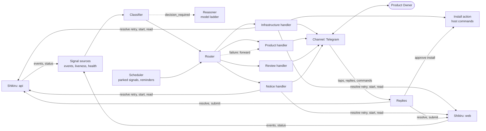

# Shikiri-yaku: design

Status: current design. No code exists yet. It builds on what [Shikiru](https://github.com/ferrum-code-dev/shikiru) provides today: its `README.md`, `docs/design.md` and the MCP server. The implementation plan and the assessment are in [plan.md](plan.md).

## 1. Idea

Shikiru runs the development: one engine per repository, with Leader and Implementer agents, review and integration. When it cannot continue on its own it raises an **escalation** and waits for a person. Today that person watches tmux.

Shikiri-yaku (the **Operator**) takes that seat. It watches the escalations and a few other signals of every Shikiru project of a product, sorts each one into a **category**, and hands it to the **handler** for that category. A handler either resolves the escalation itself or forwards it to the Product Owner (PO) through a chat channel (Telegram first). The PO answers with a button or a short reply, and the Operator applies the answer in Shikiru.

The first release has four handlers:

* **Product**: forwards the escalation to the PO.
* **Infrastructure**: retries, waits for quota resets, restarts engines and, after the PO approves the exact command, installs a missing tool. Whatever it cannot fix it forwards.
* **Review**: sends the PO the link of a pull request that waits for review (Shikiru's pull-request integration mode).
* **Notice**: tells the PO that a task is done, or that the Operator itself has a problem.

Everything else the Operator might do later (routine decisions, goal intake, digests, more repair actions) is added as a rule, handler, action, Reasoner job or channel. The core does not change ([§13](#13-extensions)).

The Operator exists to remove idle time: work waiting for a person who is not watching, and problems a person would have fixed with one command. Its success is measured by PO wait time and by the share of signals handled without the PO ([§15](#15-proving-it-works)).

## 2. Principles

1. **Shikiru is the source of truth.** Tasks, escalations, their state and history live in Shikiru and are read and changed through its MCP server only (plus the `start` and `doctor` commands of its CLI). The Operator keeps no copy of the backlog and never touches Shikiru's database.
2. **A small fixed core, growth by extension.** Watching, sorting, routing, replying and journaling are the core. Categories, handlers, actions, Reasoner jobs and channels are extensions, wired in one place.
3. **Every route ends at the PO.** An unknown signal, an unsure classification, a failed or exhausted handler, or a model that is down all mean *forward to the PO*. Nothing is dropped, and a new extension can never do worse than plain forwarding.
4. **Agents propose, code acts.** The Operator's reasoning agent may look things up with read-only tools but cannot change anything, and returns typed data. Code validates it, builds every command from it, and runs only what the PO has approved. A model never writes a shell command.
5. **Journal before acting, check after.** Every effect (a Shikiru command, a host command, a message) is recorded before it happens, and success is checked by observation, not assumed.
6. **No model is needed to stay useful.** Watching, rule-based sorting, forwarding and replies are plain code. With every model down the Operator still forwards everything.
7. **Nothing of the Operator is stored in the managed repositories,** just as Shikiru keeps its own state out of them.
8. **If the Operator needs something Shikiru does not offer, add it to Shikiru** instead of working around it in the Operator. If the gap is rare and does little harm, accept it and write down what would make us fix it: a *candidate* with a trigger ([§11](#11-shikiru-what-is-used-what-is-needed)). The structured escalation view (S1) is the first case; the `submit_task` key is the second.
9. **KISS and YAGNI.** Anything not needed by the first release is listed as an extension with the trigger that brings it back, not built.

## 3. Architecture



Every module reads and writes the **Journal** ([§9](#9-journal)); it is left out of the picture. The Reasoner is used only by the Classifier: its verdict is stored with the signal, and the Install action reads it from there.

One Python process with one asyncio loop, one SQLite journal, one TOML config and the OS service manager. Modules, not services:

| Module | Responsibility | Uses a model? |
|---|---|---|
| **Signal sources** | An event source (one supervised `shikiru --project P mcp` link per project, durable cursor), a liveness source (engine up or down) and a health source (the Operator's own links and Reasoner). All only produce signals ([§4](#4-signals)) | No |
| **Classifier** | An interface that assigns a category to a signal. The first implementation is an ordered rule table; for `decision_required` it asks the Reasoner ([§5](#5-classification)) | Only for `decision_required` |
| **Router** | Finds the handler for a category and turns every failure into a forward | No |
| **Scheduler** | Wakes parked signals and sends due reminders | No |
| **Loop guard** | Limits automatic actions per cause, from the journal ([§6](#6-handlers)) | No |
| **Handlers** | Product, Infrastructure, Review and Notice ([§6](#6-handlers)) | Infrastructure: through the Reasoner's verdict |
| **Reasoner** | One job, `assess_blocker`, behind an interface; adapters that call agent CLIs with read-only tools, tried in a ladder ([§8](#8-reasoner)) | Yes |
| **Install action** | Host facts, command building, approval, running, checking ([§6.3](#63-install-a-missing-tool)) | No |
| **Channel** | Interface plus the Telegram adapter: outbox, inbound dedupe, sender allow-list ([§7](#7-the-po-channel)) | No |
| **Replies** | Looks up the purpose of the message an inbound item belongs to (`question`, `approval`) and maps button taps, replies and commands to Shikiru commands or to the install action | No |
| **Journal** | SQLite store ([§9](#9-journal)) | No |

**Extensions.** A category, its classification rules, its handler and the handler's actions form one **extension**: one folder of code, registered in one place. The first release registers four: product, infrastructure, review, notice. Rules and handler of an extension are never spread over the core ([§12](#12-engineering-rules)).

**Why a separate service, not a plugin in an agent session.** Watching, pending questions and message delivery must keep working when an agent runs out of quota, changes or crashes.

### 3.1 One instance per product

A product consists of one or more **components**; each component is one Shikiru project (one repository), on this machine or on another host. One Operator instance serves one product: a directory `~/.shikiri-yaku/<product>/` (the **instance directory**) with `config.toml` ([§3.2](#32-configuration)), `journal.db`, `secrets/` and `output/` (install logs); a service unit named `shikiri-yaku-<product>`; and one chat bot. `--home <dir>` replaces `~/.shikiri-yaku`. The commands take the product name (`shikiri-yaku run shop`, `doctor shop`, `install-service shop`); the config is written by hand and `doctor` validates it. `run` holds `instance.lock` in the directory, so a product never runs twice. Several products mean several instances. There is no registry of products.

* **A bot per product.** Telegram allows one long-polling consumer per bot token, and the chat itself shows the PO which product is speaking.
* **Shared on the host:** one lock file for running host commands (`~/.shikiri-yaku/host.lock`), so two instances never change the host at the same time. A component on another host has its own lock on that host. Two instances pointed at the same repository is a configuration mistake that `shikiri-yaku doctor` warns about; nothing else guards against it.

### 3.2 Configuration

One `config.toml` in the instance directory. Agent ladders, models and integration settings of the *projects* stay in each project's Shikiru configuration; this file holds only what the Operator itself needs.

```toml
product = "shop"

[[components]]                  # one per Shikiru project
name = "api"
path = "~/src/shop-api"

[[components]]
name = "web"
path = "~/src/shop-web"
# host = "build-box"            # optional: ssh destination of a remote project; default is this machine

[channels.telegram]
token_file = "secrets/telegram.token"   # mode 0600; never in the journal, chat or a repository
owners = [123456789]                    # allow-listed user ids

[reasoner]                      # optional: without it every decision_required goes to the PO
ladder = ["claude:<model>:<effort>", "codex:<model>:<effort>"]   # tried in order
timeout_s = 120
cooldown_min = 5                # a rung that failed is skipped for this long
max_parallel = 2

[operator]
liveness_interval_s = 60
stop_grace_min = 2              # a clean engine stop is respected after this long (§4)
lost_command_min = 2
link_unreachable_min = 10

[handlers.infrastructure]
command_timeout_min = 10
quota_wait_max_h = 24
retry_budget_per_day = 1
restart_budget_per_hour = 1
approval_expiry_h = 24

[handlers.product]
reminder_first_h = 4
reminder_repeat_h = 24
```

Every value except `product`, `components` and `channels.telegram` has a default, and **every number in this document is such a setting** (liveness interval, `stop_grace_min`, lost-command wait, unreachable-link time and so on), except the limits that belong to others: Telegram's message and button sizes and the name validation of [§6.3](#63-install-a-missing-tool). A remote component runs its Shikiru link, its `start` and its host commands through ssh on that host; the first release implements the local case only ([§13](#13-extensions)). `shikiri-yaku install-service` writes the service unit with the PATH of the user's login shell, so `shikiru` and the agent CLIs are found when launchd or systemd starts the process. A component is added or removed by editing the file and restarting; a removed component's open signals are closed with a note. `shikiri-yaku doctor` validates the file, the paths, the token, each project's MCP link and the Reasoner's CLIs.

## 4. Signals

A **signal** is one thing that may need attention. All signals have the same shape, so classification and routing do not care where they came from:

| Field | Meaning |
|---|---|
| `id` | Stable identity, unique in the journal (below) |
| `project`, `task_id`, `escalation_id` | Where it happened, when known |
| `kind` | `escalation`, `engine_down`, `engine_fault`, `task_done`, `pr_review`, `health` |
| `reason` | The escalation `reason` from Shikiru, or the stop reason of an engine |
| `text` | The escalation headline and question, or the event message |

**Identity.** An id has one pattern, `<project>:<kind>:<source id>`, and must come out the same after a restart, so duplicates are impossible:

| Signal | Source id | Example |
|---|---|---|
| `escalation` | the escalation id | `api:escalation:E12` |
| `task_done`, `engine_fault`, `pr_review` | the id of the event | `api:task_done:5531` |
| `engine_down` | the id of the newest event of that project | `api:engine_down:5540` |
| `health` | what failed and when it started (scope `operator` for the Reasoner) | `api:health:link:2026-10-27T08:00Z` |

**Event source.** One reader per project long-polls `wait_for_events(since_id)`. These events matter:

| Event | Effect |
|---|---|
| `escalation` (data: `escalation_id`, `reason`) | A signal; its text comes from `get_escalation` |
| `task_done` | A signal |
| `pr_opened` (data: `url`, `branch`, `commits`; Shikiru's pull-request integration mode) | A `pr_review` signal; the task stays *integrating* until the PR is merged or closed |
| `pr_withdrawn` | Closes the open `pr_review` signal of that task |
| `engine_stopped` that carries a stop reason (Shikiru stopped the engine because of repeated faults) | An `engine_fault` signal |
| `escalation_resolved` | Closes the open signal of that escalation, whoever resolved it ([§10](#10-restarts-and-failures)) |
| `engine_started`, `engine_stopped` | Update the project's lifecycle state in `cursors`; no signal |

A `pr_review` signal also closes when its task is `task_done` (merged) or raises a `pr_closed` escalation (closed unmerged).

Everything else is ignored, including the `engine_fault` events of an engine that is still running: Shikiru retries those itself, and if they persist it stops the engine, which is the signal above. The cursor advance and the journal rows it causes commit in one transaction, so a crash replays at most one batch, and signals are deduplicated by id.

**First sync of a project.** Read all events once (paging until none are left) and keep only the state: the lifecycle and which pull requests are still open (a `pr_opened` with no later `pr_withdrawn`, `task_done` or `pr_closed` escalation for its task); then create signals for the currently open escalations from `list_escalations` and a `pr_review` signal for each open pull request; the cursor is the last event read. History is never replayed as signals, but a pull request waiting for the PO is current state, not history. A clean stop already in the history counts as respected (below), so a project the PO left stopped is not restarted when the Operator is first installed.

**Liveness source.** A crashed engine raises no escalation. Every minute the source reads `status.engine_up`:

| Engine up? | Last lifecycle event | Result |
|---|---|---|
| yes | any | nothing |
| no | `engine_started` | The engine died: an `engine_down` signal |
| no | `engine_stopped` with a reason | Already signaled as `engine_fault`: nothing more |
| no | `engine_stopped` without a reason | See below |
| no | none ever recorded | The project was never started: shown in `/status`, not restarted |

**A clean stop.** Shikiru stops gracefully on SIGTERM and records `engine_stopped` without a reason, so a deliberate stop by the PO and a host shutdown look the same. The Operator tells them apart by time. If the engine is still down `stop_grace_min` (default 2) after a stop that happened while the Operator was running, the stop is **respected**: its event id is saved in `cursors` and it never triggers a restart, also after the Operator itself restarts. A clean stop that happened before the current run started and was never respected (the Operator was down, or stopped within the grace time, as happens at a reboot) is treated as `engine_down` at once. The cost: a project the PO stopped while the Operator was down is started again, and the PO stops it once more.

If the cursor falls behind Shikiru's retention, the source repeats the first sync.

**Health source.** The Operator's own problems are signals too: a project's MCP link that stays unreachable for `link_unreachable_min` (default 10), and the Reasoner when its whole ladder fails ([§8](#8-reasoner)). A `health` signal opens once on the failure, closes on recovery, and is not repeated while it stays open.

PO messages are not signals. They go through Replies ([§7](#7-the-po-channel)).

## 5. Classification

A **category** names who should deal with a signal. Categories are an open set; the first release has four:

| Category | Meaning | Handler |
|---|---|---|
| `product` | Needs the PO: a product choice, a delivery decision, or anything unsure | Product |
| `infrastructure` | A problem of the machine, the agents or the workflow that code may fix | Infrastructure |
| `review` | Work waits for the PO's review | Review |
| `notice` | Information, nothing to decide | Notice |

**The Classifier is an interface:** `classify(signal) → Classification(category, source, note)`. The first implementation, `RuleClassifier`, applies the rules that the registered extensions contribute. A decision model or a general LLM can replace or precede it later by changing only the composition root; the categories it may choose from come from the registered extensions.

**Rules.** Each extension contributes its own rules, and the classifier checks them in registration order, first match wins. The product extension registers last, and its catch-all rule is the fallback. Startup fails if two extensions claim the same reason. Every signal except `decision_required` is sorted by its typed `reason` or `kind`, at no token cost. A reason Shikiru adds later falls to the catch-all. Together the rules read:

| Signal | Category | Rule of | Why |
|---|---|---|---|
| `decision_required` | The Reasoner's verdict: `host_tool` gives `infrastructure`, anything else `product` | infrastructure | Only the text says what kind of question it is |
| `integration_conflict`, `integration_blocked`, `agent_error`, `agent_stuck`, `agent_protocol` | `infrastructure` | infrastructure | Shikiru's own recommended option is a retry |
| `quota_exhausted`, `ladder_exhausted` | `infrastructure` | infrastructure | Waiting for the reset is the usual answer |
| `engine_error`, `engine_down`, `engine_fault` | `infrastructure` | infrastructure | Restart, then forward |
| `pr_review` | `review` | review | The PO merges or rejects the pull request |
| `task_done`, `health` | `notice` | notice | Information |
| anything else, including `iterations_exhausted`, `pr_closed`, `dependency_cancelled`, `agent_auth`, `uncommitted_work`, `off_task_branch` | `product` | product | Each needs a person; no action exists yet |

**`decision_required`.** Without a configured Reasoner this is always `product`, so the first phases forward it at once. With one, the question waits for the verdict at most `reasoner.timeout_s`. Before the verdict, code collects host facts (OS, which package managers exist, PATH). The Reasoner's `assess_blocker` job ([§8](#8-reasoner)) reads the reason, the question, the agent's options and these facts. Its verdict is `host_tool` (a program is missing on the machine), `project_dependency` (a library the project itself must declare) or `other`. On a model failure, a timeout, an invalid answer or any other verdict the category is `product`, and the model's one-line suggestion becomes a note on the message, marked as model-written; when the Reasoner failed, the note says so. A `project_dependency` is never installed on the host: it would work here and fail everywhere else, and the fix is a change to the project's dependency file, which is the agent's job. The PO sees the suggestion "add it to `<file>`". The Operator never writes into a repository. A wrong verdict is cheap by design: the infrastructure path forwards whatever it cannot fix, and it never acts on the host without the PO's approval. Verdicts are logged with the signal so misroutes can be reviewed by hand ([§15](#15-proving-it-works)). If they prove unreliable, a typed category set by the asking agent becomes a Shikiru requirement.

**Extending.** A new category is an extension: its rules (or a new Reasoner verdict), a handler and its actions, registered in the composition root. For example `access` routed to a technical contact, or `spend` for metered usage.

## 6. Handlers

A handler takes one signal and returns one **outcome**:

```python
class Handler(Protocol):
    async def handle(self, signal: Signal) -> Outcome: ...

Outcome = Resolved(note) | Forward(note) | WaitUntil(time, note)
```

* `Resolved`: the handler applied a fix in Shikiru; the signal closes.
* `Forward`: the signal goes to the product handler, with the note saying what was tried and why it stopped.
* `WaitUntil`: the signal is parked with a wake-up time and dispatched to the same handler again then. The handler records what it is waiting for as an op of kind `wait`, so on the second call it finds that op due and performs the follow-up action instead of waiting again.

Each handler gets what it needs through its constructor (the Channel, the journal and its actions), so its dependencies are visible and fakeable ([§12](#12-engineering-rules)). A handler that does several things, as the Infrastructure handler does, receives them as **actions**: small objects `Action.run(signal) → Outcome`, each built with its own dependencies (the Shikiru client, the install action, the loop guard) and registered with the reasons it covers. A new action is added without editing the handler, and tests use fake actions. The handler registry is a plain dictionary built in the composition root.

**The Router guarantees the fallback.** An exception, a timeout or an unknown category becomes `Forward`. Signals are handled as independent asyncio tasks, and the only shared resources are the host lock and the Reasoner (at most `reasoner.max_parallel` calls at once).

**Loop guard.** An automatic action is recorded in `ops` with its `(project, task, reason, action)`. A handler asks the guard before acting. Budgets: `retry_budget_per_day` (default 1) retry per `(project, task, reason)` per 24 hours, and `restart_budget_per_hour` (default 1) engine restart per project per hour. A spent budget becomes `Forward` with the history, so a fix that does not hold never loops.

### 6.1 Product handler

It forwards. The message is a template over Shikiru's fields, so it needs no model:

> **Shop · api · T-12 · Decision needed**
> *Export invoices older than 90 days?* The payment provider only keeps 90 days of invoices.
> ★ A. Ship export for new invoices now (history later)
> B. Add a second data source first (delivery moves)
> *What I tried:* nothing, this is a product question.
> [A] [B] [Reply with text] [Cancel task] [Details]

* **Content.** The question, the agent's options with consequences and the ★ come from the structured escalation view ([S1](#11-shikiru-what-is-used-what-is-needed)). For escalations that carry no agent options, the buttons are Shikiru's own resolutions (`retry`, `accept`, `cancel`, with their consequences), each offered only where the escalation allows it. A reason-specific hint is added for a few reasons, from a small table in code (for example `agent_auth`: log in again in a terminal, then tap Retry). The note of a forwarding handler is added as *What I tried*.
* **Answers.** An option button resolves the escalation with `answer` and the option's label and consequences as text. An option that needs input asks for a reply first. A free-text reply to the message is sent as the answer. `accept` (integrates the work as it stands) and `cancel` ask for a confirming tap.
* **Signals without an escalation** (a stopped engine that could not be restarted, or a notice, review or health message whose own handler failed) are shown as information with an *Acknowledge* button. They close when acknowledged or when the engine is up again, and do not repeat while the engine stays down without new events.
* **Reminders.** An unanswered message is reminded after `reminder_first_h` (default 4) hours, then every `reminder_repeat_h` (default 24). Silence never approves anything.

### 6.2 Infrastructure handler

The handler picks an **action** by the signal's reason or kind, from a dictionary built from the registered actions:

| Signal | Action | Outcome |
|---|---|---|
| `agent_error`, `agent_stuck`, `agent_protocol`, `integration_conflict`, `integration_blocked` | **Retry**: `resolve_escalation(retry)` at once. Shikiru has already backed off before escalating | `Resolved`; a second escalation of the same cause forwards (loop guard) |
| `quota_exhausted`, `ladder_exhausted` | **Wait**: the reset time is the latest `resets_at` among the exhausted windows (`used_pct` of 100 or more) in `status.quotas`. Tell the PO the time, record a `wait` op, park until then plus one minute, then `resolve_escalation(retry)` | `WaitUntil`; no known reset time, or one more than `quota_wait_max_h` away, forwards |
| `engine_down`, `engine_fault` (a fault stop) | **Restart**: `shikiru --project <path> start`, then confirm `status.engine_up`. Shikiru resumes its tasks itself. This also brings engines back after a host reboot | `Resolved`; a second restart within an hour forwards with the failed checks of `shikiru doctor --json` |
| `engine_error` | **Restart** as above if the engine is down, then `resolve_escalation(retry)` | As above |
| `decision_required` with verdict `host_tool` | **Install a missing tool** ([§6.3](#63-install-a-missing-tool)) | `Resolved` after the check passes; any failure forwards |

Shikiru already waits for quota resets of up to 8 hours on its own, so a `quota_exhausted` escalation means the reset is further away or unknown. The Operator uses `resolve_escalation(retry)`, never `retry_task`. The first is rejected by Shikiru if the escalation is already resolved; the second interrupts and requeues whatever the task is doing, so repeating it after a restart would be harmful. Product code is never repaired by the Operator; retrying gives the work back to Shikiru's agents.

### 6.3 Install a missing tool

The Operator runs as the PO's user, so a command the PO approved is the same as one the PO ran. The Reasoner only points at *what* is missing. **Code builds the command.**

```
decision_required, verdict host_tool
  → validate        code: tool, manager and package fields
  → check before    code: command -v <tool>
  → approval        PO taps Install or Decline
  → run             code, under the host lock
  → check after     code: command -v <tool>
  → resolve         answer "Installed <tool> ..." to the Leader
```

1. **Validate.** The Reasoner returns `tool` (an executable name), `manager` and `package`. Code accepts them only if the names match a strict pattern (letters, digits, `.`, `_`, `-`, `+`, and for npm `@` and `/`; at most 100 characters), the manager is on the allow-list and exists on the host, and the pair has a recipe. Anything else is forwarded. Recipes are fixed argument lists, never a shell string:

   | Manager | Command |
   |---|---|
   | `brew` | `brew install <package>` |
   | `uv` | `uv tool install <package>` |
   | `npm` | `npm install -g <package>` |
   | `pipx` | `pipx install <package>` |
   | `cargo` | `cargo install <package>` |

   The recipes are rows of one table in code; supporting another user-level manager means adding a row and its name pattern. These managers work the same on macOS and Linux and need no root. A system package manager (`apt`, `dnf`), `sudo` or any other command is never run: they need a password the Operator cannot enter. The signal is forwarded with the suggestion, and the PO runs it personally and answers "done". A model writing the command itself is the "free-form approved commands" extension ([§13](#13-extensions)).
2. **Is it really missing?** Code runs `command -v <tool>` in the user's login shell. It is built from the validated name, so it is safe to run before approval. If the tool is found, nothing is installed: the agent could not see a tool that exists, which points to its PATH or sandbox. The signal is forwarded with the path found.
3. **The PO approves the exact command.** The message shows the tool, the model's reason (marked as model-written), the command as code built it, the manager, and the effect: "adds `<tool>` for every component on this host; the package manager may also update dependencies of that tool". The command and the argument list are stored in `ops` before the message is sent, and what runs is that stored list, never re-derived. **Decline** forwards the original escalation. The approval is taken once, by a conditional state change in `ops` (`intended → approved`), so two taps cannot start two installs. An approval older than 24 hours, or for an escalation that was resolved elsewhere, is void.
4. **It runs like the PO would run it**: the argument list is quoted and run through the user's login shell (`$SHELL -lc`) so PATH and tool setup match the PO's terminal; with closed stdin and non-interactive variables (`CI=1`, `NONINTERACTIVE=1`); in a scratch directory outside every repository; with a timeout (`command_timeout_min`) after which the whole process group is killed. A password prompt fails fast. One host command runs at a time, under the host lock.
5. **Success means the check passes,** not exit code 0. The output goes to a file in the instance directory, and on failure its tail goes to the PO with the forward.
6. **Resolve.** `resolve_escalation(answer)` with "Installed `<tool>` with `<manager>` (found at `<path>`). Please continue." Only `answer` and `cancel` exist for `decision_required`, so a retry is not available here.
7. **Journaled before it runs.** After a restart an interrupted install is never repeated blindly: the check decides, and if it fails the PO is asked again.

### 6.4 Review handler

Shikiru's pull-request integration mode opens a pull request for a finished task and keeps the task *integrating* until the PR is merged or closed. Nobody is asked, so there is no escalation; the PO simply has to look. The handler sends the link:

> **Shop · api · T-12 · Pull request ready for review**
> *Export invoices older than 90 days* · 3 commits
> [Open PR] [Acknowledge]

* **Content.** The task title comes from `get_task`; the link and the commit count from the `pr_opened` event. *Open PR* is a link button. The Operator does not merge, comment or review.
* **Closing.** The signal closes when the task is done (merged), when the PR is withdrawn, or when Shikiru escalates `pr_closed`; the message is then edited to its final state. *Acknowledge* only silences the reminders.
* **Reminders** follow the Product handler's. A PR left unmerged beyond Shikiru's wait budget raises `integration_blocked`; the retry of the Infrastructure handler then just starts another wait, spent once by the loop guard, and the review message and its reminders continue.
* **Later:** a review by an agent or by the CI's review agents is another handler for the `review` category, which forwards only when asked ([§13](#13-extensions)).

### 6.5 Notice handler

**Task finished.** A plan task spawns child tasks, so a message per `task_done` would be noise. On each `task_done` the handler reads `list_tasks`, follows `parent_id` to the family root, and stays silent while any task of that family is `queued`, `running`, `integrating` or `escalated`. When none is left it sends one message per family root: "api · *root title* integrated (N tasks)". Its key is recorded in `messages`, so the message is never sent twice. Shikiru records a task as done only after integration settles, so the message says *integrated*, and release is not tracked.

**Health.** A `health` signal becomes one message ("Reasoner unavailable: every rung failed; decisions are forwarded without a suggestion", "api: Shikiru link down for 10 minutes"), edited to "recovered" when the signal closes.

The infrastructure handler sends its own messages when it acts (a quota wait and its time, an engine restart) through the same Channel. A daily digest is a later extension.

## 7. The PO channel

**Channel interface.** `send(destination, message) → message_ref`, `edit(message_ref, message)`, and a stream of inbound items (button tap, reply, text, command), each with the sender. A **destination** says where a signal's message goes; the adapter decides it from the signal's project and kind. An adapter implements the interface for one platform; the first release has Telegram only, and the Router and handlers know only the interface.

**Telegram adapter.** One bot per instance, long polling, inline buttons, edit in place. Updates are saved before the offset advances. Only allow-listed user ids are served. In the first release the destination is the private chat with each owner. A group with one forum topic per component, one topic for all other signals, and a bot that manages the topics is the first extension after the relay ([§13](#13-extensions)); it changes only the destination function and a startup reconcile, not the handlers.

* **Size limits.** A message is at most 4096 characters. A long question or option list is cut to fit, with a *Details* button that sends the full packet text in parts. Button data is at most 64 bytes, so it carries numbers only: `a:<signal no>:<option no>` selects a choice (every escalation choice, including answer, retry, accept and cancel, has an option number; input and confirmation follow from the choice), `d:<signal no>` is *Details* and `k:<signal no>` is *Acknowledge*. The signal number is the journal row id (shown as `S41`).
* **Answers apply once.** Replies are matched by the message they reply to; an approval message accepts only its buttons. Shikiru rejects a resolution for an escalation that is no longer open, so "first answer wins" is Shikiru's guarantee; the Operator tells the later answer "Already resolved: B at 12:03" from its own journal. After resolving, every copy of the message is edited to its final state and its buttons are removed ([§10.1](#101-commands-to-shikiru)).

**Commands.**

| Command | Effect |
|---|---|
| `/status` | Per component: engine up, down or never started; running, queued and escalated tasks; quota blocks |
| `/open` | Open escalations and pending approvals, with their buttons again |
| `/goal <component> <text>` | `submit_task` in that component with the text as the request; Shikiru's Leader triages and plans it. The PO gets the task id and later its `task_done` notice. With topics, the component is the topic's and can be left out |
| `/help` | The list |

Free text that is neither a reply nor a command gets the command list. Reading free text with a model is a later extension.

**`/goal` and restarts.** The command is journaled as an op before it is sent, identified by the Telegram update id, so a duplicate delivery cannot submit twice. If the Operator dies after queueing the task but before recording Shikiru's acknowledgement, it cannot tell whether the task exists, and Shikiru's submit cannot be safely repeated. After a restart such a goal is not resubmitted. The PO gets: "I may have submitted this already: *text*. Check `/status`, or tap Submit again."

**Secrets never travel through chat.** A message that looks like a secret is refused and, where the platform allows, deleted.

## 8. Reasoner

A thin module: an interface, one job, and adapters tried in a ladder.

| Job | Input | Output (schema-checked) |
|---|---|---|
| `assess_blocker` | Escalation reason, question and agent options; host facts | `verdict` (`host_tool`, `project_dependency`, `other`), `tool`, `manager`, `package`, `why`, `suggestion` |

* **Adapters.** An adapter runs one agent CLI headless with an input cap, a timeout and a JSON schema for the answer, in a scratch directory so no repository instruction file is loaded. Claude and Codex are two adapters; another agent is another adapter.
* **Ladder.** `reasoner.ladder` lists rungs written like Shikiru's agent specs, `adapter:model:effort`, tried in order. Any failure of a rung (quota, login, timeout, invalid output) moves to the next, and a rung that failed is skipped for `cooldown_min`, so a dead rung does not add its timeout to every question. The ladder is a wrapper behind the same interface, kept in memory, with no quota accounting of its own. When every rung fails the result is `Forward`.
* **Limited tools, not none.** The job may look things up so that its answer rests on the current state of the world and not on the model's memory: web search and documentation fetch, read-only package queries (`brew info`, `brew search`, `command -v`), and reading the scratch directory. It may not write files or run anything else. The tool limit is defence in depth. The guarantee that matters does not depend on the model: code validates every name and builds the command, and the PO approves it. The residual risk is that injected escalation text steers a web fetch; the same text already goes to Telegram. The first task of the Reasoner phase is a spike that confirms the flags for "tools limited" and "schema-checked answer" on the installed Claude and Codex CLIs. An adapter whose CLI cannot restrict tools runs with none.
* **Untrusted text in, data out.** Escalation and log text is evidence, never an instruction. The output is validated, every name is checked by code, and the model never supplies a command.
* **Failures are visible.** A forwarded message says when the Reasoner failed and why. When the whole ladder fails, the health source raises one `health` signal, closed on the next success, so the PO is told once that decisions arrive without a suggestion, not on every call. `/status` and `doctor` show the state of each rung.
* **Usage and timing** are logged per call in the signal's verdict record when the CLI reports them. They are not part of Shikiru's usage ledger; the calls are few and cheap.

New jobs (writing briefs, reading free text, summaries) are added here with their schemas. A second infrastructure kind is the trigger to split `assess_blocker` into classification and preparation.

## 9. Journal

One SQLite file (WAL), written only by the Operator. Its contents are small, and most of it can be rebuilt from Shikiru.

| Table | Contents | Why it must survive a restart |
|---|---|---|
| `cursors` | Per project: last event id, last lifecycle event, and the id of the last respected clean stop | Resume without losing or replaying events; the liveness rule |
| `signals` | Id and number, project, kind, reason, text, category and who set it (rule or Reasoner, with its verdict and timing), handler, state (`new → handling → parked \| forwarded → answered → resolved`, or `closed`), notes, wake-up time | Deferred work, no double handling, misroute review |
| `messages` | Signal, channel, chat, platform message id, purpose (`question`, `approval`, `notice`; review and health messages are notices), a unique key for notices (`done:<project>:<root task>`), delivery state; inbound items for dedupe | Edits, reminders, duplicates recognized |
| `ops` | Every effect: kind (`resolve`, `start`, `submit`, `install`, `wait`), identity or Telegram update id, project, task, reason, payload (for an install: the exact argument list), state `intended → [approved] → issued → confirmed \| failed \| unknown`, Shikiru's command id, output path, timestamps | Safe restart, the loop guard, approvals that run exactly what was shown |

The schema is created and changed by numbered migrations applied at start, as in Shikiru. Logs go to the service manager (stderr); the journal is the audit trail.

Not stored: tasks, escalation packets, logs, agent usage. They stay in Shikiru and are read on demand. There is no retention job and no scheduled backup in the first release; the file is small, so copying it is enough ([§13](#13-extensions)).

## 10. Restarts and failures

On start the Operator takes `instance.lock` ([§3.1](#31-one-instance-per-product)), then:

1. **Ops.** Every op that is not final is reconciled by observation ([§10.1](#101-commands-to-shikiru)): a `resolve` by the escalation's state and events, a `start` by `status.engine_up`, an `install` by its check, a `submit` by asking the PO.
2. **Signals.** Signals that were `new` or `handling` when the Operator stopped are handled again: a handler may run twice for one signal, so its effects are keyed by the signal (an op identity, a message per signal). Parked signals whose wake-up time has passed are dispatched. Open forwarded messages are re-sent only if their delivery was not confirmed, carrying their stable reference (`S41`), so a duplicate is recognizable.
3. **Sources.** The liveness rule of [§4](#4-signals) runs at once.

**Other failures.** A broken MCP link is restarted with backoff, and the PO is told through a `health` signal if a project stays unreachable for `link_unreachable_min`. With the Reasoner down everything that needs it is forwarded, and one `health` signal says so ([§8](#8-reasoner)). The service manager restarts the Operator.

### 10.1 Commands to Shikiru

Shikiru queues every command durably and answers `done`, `rejected` or `queued` (the engine is down, so the command waits). There is no tool to look up a command's result later, so the Operator confirms by observing:

| Command | Confirmed when | Otherwise |
|---|---|---|
| `resolve_escalation` | The `escalation_resolved` event carries the command id from the acknowledgement | `rejected` is shown to the PO with Shikiru's message ("already resolved", "resolution not valid for this reason"). A `queued` command whose escalation is still open `lost_command_min` (default 2) minutes after the engine is up again counts as lost, and the question is shown again |
| `start` | `status.engine_up` is true | Counted against the restart budget |
| `submit_task` | The acknowledgement, which carries the task id | Uncertain after a crash: ask the PO ([§7](#7-the-po-channel)) |

**Resolved elsewhere.** The PO may answer in tmux or the dashboard. An `escalation_resolved` event for an open signal that the Operator did not cause closes it, and every copy of its message is edited to "Resolved in Shikiru: *resolution*".

## 11. Shikiru: what is used, what is needed

**Used as it is** (verified in Shikiru's code):

| Capability | Used for |
|---|---|
| `wait_for_events`, `status` (`engine_up`, quotas with `resets_at`), `list_escalations`, `get_escalation` (the escalation, its packet text and allowed resolutions), `list_tasks`, `get_task` | Signals, messages, `/status` |
| `resolve_escalation` with `answer`, `retry`, `accept`, `cancel`; rejection when the escalation is no longer open or the resolution is not valid for its reason; the command id in the `escalation_resolved` event | Applying answers exactly once, and confirming them |
| `submit_task` | `/goal` |
| `engine_stopped` carries a stop reason only on a fault stop; `pr_opened` (with `url`) and `pr_withdrawn` events; a task stays *integrating* until its PR settles | The liveness rule; the review handler |
| CLI `shikiru --project <path> start`, `doctor --json` | Engine restart and diagnostics |

**Required.**

| # | Requirement | Why |
|---|---|---|
| **S1** | **A structured escalation view.** `get_escalation` and `list_escalations` also return `question`, `agent_options` (each with `label`, `consequences`, `recommended`, `needs_input`) and `resolutions` (each with `kind`, `consequences`, `recommended`), taken from the packet by Shikiru's own parser, which the dashboard already uses. The `packet` text stays for the *Details* button | Without it the Operator would parse Shikiru's markdown packet format, which breaks silently when the format changes. Small and read-only: no engine, store or migration change |

**Candidates, each added only when its trigger appears:**

| Candidate | Trigger |
|---|---|
| An idempotency `key` on `submit_task` | A duplicate task from a crash, or goal intake that submits tasks without a human |
| A typed `category` set by the asking agent | Reasoner verdicts prove unreliable |
| An escalation summary in product language | The PO finds raw questions hard to answer |
| The newest event id in `status` | The first sync of a long-running project is too slow |
| Filtering by task family | Goal tracking across components is built |
| A `contract_version` in `status` | The first incompatible Shikiru change |
| The cause of a stop in `engine_stopped` (user command, signal, host shutdown) | The grace-time rule for clean stops ([§4](#4-signals)) restarts or respects the wrong engines in practice |

## 12. Engineering rules

The Operator is built by Shikiru's agents, so these rules go into the repository's `AGENTS.md` from the first commit, and the quality gate (the same checks as Shikiru's `poe check`) enforces what it can.

**Structure.**

```
shikiri-yaku/
  src/shikiri_yaku/               # the importable package name needs underscores
    domain/       signals, categories, outcomes, rule and extension types   (pure, no I/O)
    app/          router, loop guard, scheduler, replies, install action, reasoner jobs
    extensions/   product/ infrastructure/ review/ notice/                  (each: rules, handler, actions)
    ports.py      Protocols: ShikiruClient, Channel, Reasoner, Classifier, CommandRunner, Clock
    adapters/     shikiru_mcp, telegram, agent_cli, subprocess runner
    journal/      SQLite access; the only place with SQL
    bootstrap.py  the composition root: the only place that builds concrete objects
    cli.py        run, doctor, install-service
  tests/
```

**Rules.**

* Dependencies point inward: `domain` imports nothing from the other packages, `app` and `extensions` import `domain` and `ports`, adapters implement ports, and only `bootstrap.py` knows concrete classes.
* One reason to change per class. The Router dispatches; the loop guard counts; the scheduler wakes parked signals; each source produces signals. A handler does not know another handler, only the Product handler via `Forward`.
* Dependencies come in through constructors. No module-level state, no service locator, no handler receiving a bag of everything.
* Time comes from `Clock`, subprocesses from `CommandRunner`, Shikiru from `ShikiruClient`, so each is replaceable and testable. The journal is concrete SQLite (tests use an in-memory database, not a mock).
* Open for extension, closed for edits: a category, handler, action, source, Reasoner job, Classifier or channel is added by writing it and registering it in `bootstrap.py`. An extension owns its rules, so the Router, the classifier and the journal do not switch on a specific category or kind.
* Failures cross a port as typed exceptions. Only the Router turns them into `Forward`; no other code swallows them.
* Names come from this document's vocabulary (signal, category, handler, outcome). Functions are short, comments explain why, and no code exists for a case this document does not describe.
* Numbers are settings with defaults in one settings object ([§3.2](#32-configuration)), not literals in handlers.

**Tests that earn their place.**

| Test | What it protects |
|---|---|
| Table-driven classifier test with **every escalation reason Shikiru has** (the upgrade smoke script compares the list with the pinned Shikiru) plus an unknown reason falling to `product`; startup fails when two extensions claim one reason | A new Shikiru reason is not silently mishandled |
| Table-driven liveness test: engine up or down against every last-lifecycle case, including a clean stop respected after the grace time and one never respected (reboot) | No engine is restarted against the PO's will, none is left down after a reboot |
| Reasoner ladder test with fake rungs: first fails, second answers; all fail; a failed rung is skipped during its cooldown | The fallback and the health signal |
| Handler tests with fakes for each outcome, including the loop guard and the Router fallback | The "every route ends at the PO" guarantee |
| Install action tests: name validation (including hostile names), recipe building, check-before, decline, failure, interrupted run | Principle 4 |
| **Crash-point tests** of the journal: kill after queueing a resolve, after an approval, mid-command, mid-send, and check the restart result | Safe restart |
| Contract tests against a real Shikiru engine with its fake agent, run by a human-launched script: events, escalations, S1 fields, `resolve` rejection, command ids in events, `start` | The assumptions about Shikiru ([§11](#11-shikiru-what-is-used-what-is-needed)) |
| Executor tests with real harmless commands: timeout, closed stdin, killing the process group | The host-command path |
| Telegram adapter tests against recorded payloads: size limits, callback data, offset handling | The channel edge |

Not worth writing: tests of message wording or snapshots, getters, config defaults, and mocks of the Operator's own internals. A coverage percentage is not a goal.

## 13. Extensions

Each item below is an extension, a handler, an action, a Reasoner job, an adapter (channel, classifier or command runner), a source or a Shikiru candidate. None changes the core.

| Extension | Kind | What it adds | Trigger |
|---|---|---|---|
| Autonomy setting | Wrapper around handlers | Approve allow-listed installs or take cheap reversible product choices without asking, announced with an undo; promoted after repeated unchanged approvals, demoted at once on a veto | The PO approves the same kind of thing repeatedly |
| Product charter | Product handler + Reasoner job | Questions the PO's written principles already answer are answered from them | Repeated questions of the same kind |
| Goal intake | Reasoner job + handler | Free-text goals turned into briefs per component, routed by a short description of each component, with cross-component order and a submit key | `/goal <component>` proves too manual |
| Plain-language questions | Reasoner job, or a Shikiru candidate | Escalation text rewritten for a non-technical PO | The PO finds raw questions hard to answer |
| Suggested-answer buttons | Product handler | A Reasoner suggestion such as "add it to `pyproject.toml`" becomes a button | The same suggestion is typed repeatedly |
| Digest and acceptance note | Notice handler | One message a day; a note on finished work against its acceptance criteria | Notices become noise |
| Free-form approved commands | Install action | Other host commands, written by the Reasoner, shown with risk flags, approved word for word; needed for system package managers and unusual hosts | Forwarded infrastructure signals of one kind recur |
| Telegram topics | Channel adapter (destination function + startup reconcile) | A product group: one forum topic per component for escalations, one for all other signals, the bot as admin with the manage-topics right; a new component gets a topic, a removed one has its topic closed with the history kept; `/goal` in a topic implies the component. The group must hold only the owners, because everyone in it sees project data. About 3 tasks | First extension after the relay; at the latest when the single chat is confusing with two or more components |
| Remote components | Command runner + MCP adapter | A component with `host`: its Shikiru link, `start` and host commands run through ssh, installs run on that host with its own facts and lock | The first project on another machine |
| Review delegation | Handler for category `review` | A pull request goes to a review agent or the CI's review agents; the PO is asked only when they ask or disagree | Reviewing pull requests is the PO's main wait |
| Model classifier | Classifier adapter | A decision model or a general LLM replaces or precedes the rules | Rule misroutes are frequent |
| System-wide actions | Install action | A privileged helper with typed verbs behind one sudoers entry | First install that needs `sudo` |
| Technical contact | Category `access` + extension | Access and login requests go to a second person | A second person exists |
| Second channel | Channel adapter | Another chat platform; answers already apply once | A real need |
| Release tracking | Action + notice | A release command and probe; reports say "released" only with it | The PO wants releases tracked |
| Housekeeping | Journal | Scheduled backup, retention, an external heartbeat URL, a rate limit on notices | The journal grows, or the service fails unnoticed |

Each gets its own short design when its trigger appears, written against the signals the first release has collected.

## 14. The nine scenarios

| # | Scenario | First release | Later |
|---|---|---|---|
| 1 | The PO describes a goal | `/goal <component> <text>`; Shikiru's Leader triages and plans; one *integrated* notice when the family is done | Goal intake |
| 2 | Development hits a technical problem | Retry, quota wait, engine restart (also after a reboot); a missing tool installed after approval; the rest forwarded with what was tried | More actions |
| 3 | The first repair does not work | Loop guard: one automatic action per cause, then forward with the history; a failed check forwards with the output | Further strategies per action |
| 4 | A real product decision | Forwarded with the agent's options and ★; one tap applies it | Charter answers, autonomy |
| 5 | Access or authority is missing | Login problems forwarded with instructions; `sudo` and system installs forwarded as instructions for the PO | Technical contact, privileged helper |
| 6 | The PO wants to know what is happening | `/status`, `/open`, *integrated* notices, pull-request review links, health notices | Digest, acceptance notes, review delegation |
| 7 | An agent becomes unavailable | Shikiru's own ladders first; quota escalations wait for the reset; the Operator's Reasoner down means forward | Spend decisions |
| 8 | The computer or the Operator restarts | Cursors, `ops`, the liveness rule (engines come back after a reboot; a stop the PO made stays respected), observation-based reconcile ([§10](#10-restarts-and-failures)) | Housekeeping |
| 9 | Several channels | The Channel interface with destinations; Shikiru applies only the first answer | Topics, second adapter |

## 15. Proving it works

**Drills**, against Shikiru with its fake agent and against two small real projects:

* A missing tool: approve, install, check, task continues. The same with Decline, a tool that is already there, a hostile package name, and a failing install.
* A transient agent error: one retry, then a forward when it repeats.
* Quota exhaustion: the wait, the message, the retry at the reset; and a reset more than 24 hours away.
* Kill an engine; kill the Operator mid-install, mid-resolve and mid-send; reboot the host and check that engines come back, and that an engine the PO stopped stays stopped across an Operator restart.
* A task in pull-request mode: the review message, the merge, the notice; and a PR closed unmerged.
* Two answers to the same question from two chats, and an answer given in tmux.
* The Reasoner unavailable: everything is forwarded with a note, one health notice, nothing lost; and a ladder whose first rung fails.

**Measures,** always on, from journal timestamps:

| Measure | Why |
|---|---|
| **PO wait time**: escalation raised to resolved, and the share spent waiting for the PO | The idle time the Operator exists to remove |
| **Handled without the PO**, per category and action | Shows which extensions are worth building next |
| **Escalation mix**: count per reason and per Reasoner verdict | Real data to decide the next handlers ([plan.md](plan.md)) |
| **Misroutes**: verdicts reviewed by hand against what the PO and the agents did (first month, every `decision_required`) | Whether classification from text is good enough |
| **Installs**: approved, declined, checks failed | Whether the install path earns its keep |

## 16. Trade-offs and limits

1. **Classification from text, not a typed field.** No Shikiru change and works with every agent. The cost is a model call per `decision_required` and possible misroutes; bounded by "unsure means product", by approval before any host change, and by reviewing verdicts.
2. **The Operator's own Reasoner, outside Shikiru.** A few cheap calls behind a small ladder, with read-only lookup tools. Failure simply forwards, so there is no quota accounting. Their usage is logged by the Operator, not in Shikiru's ledger.
3. **Forward by default.** The first release saves the PO the infrastructure interruptions it can fix and makes every other one answerable from the phone. Product questions still reach the PO in the agent's own words, which a non-technical PO may find hard to answer; plain-language questions are an extension with a measurable trigger.
4. **Typed install recipes, not free-form commands.** Safer and simple, but only five user-level package managers are covered, and system managers that need `sudo` are not. Anything else is forwarded as instructions.
5. **The PO approves host commands,** but sees only commands that code built from validated names, so the approval is not a review of model-written shell.
6. **A retry may often fail.** Shikiru has already retried within its own budgets before it escalates. The loop guard bounds the cost, and the mix measure shows whether retries pay.
7. **No cross-component planning yet.** The PO names the component in `/goal`. Splitting one goal over several components is an extension.
8. **A rare duplicate goal.** A crash at the wrong moment can leave a `/goal` uncertain; the PO is asked rather than the Operator guessing.
9. **A stale engine environment.** The engine keeps the environment it was started with, so a tool installed into a new directory may still be invisible to the agents until the engine restarts. The success message gives the full path so the agent can call the tool directly.
10. **Escalation text leaves the host.** Questions go to Telegram automatically, and *Details* sends more of the packet on request. Packets can contain project data. The PO decides what the chat may hold by choosing the bot and its owners.
11. **One host, one channel.** Not highly available. A lost Telegram acknowledgement can produce a duplicate message, which carries its reference.
12. **A clean stop is judged by time.** Shikiru does not record who stopped the engine, so a stop is respected only after `stop_grace_min` with the Operator running. A project the PO stopped while the Operator was down is started again.
13. **An unmerged pull request may cost one retry.** Shikiru raises `integration_blocked` when a PR waits beyond its budget; the first retry just waits again, and the loop guard forwards the second.
