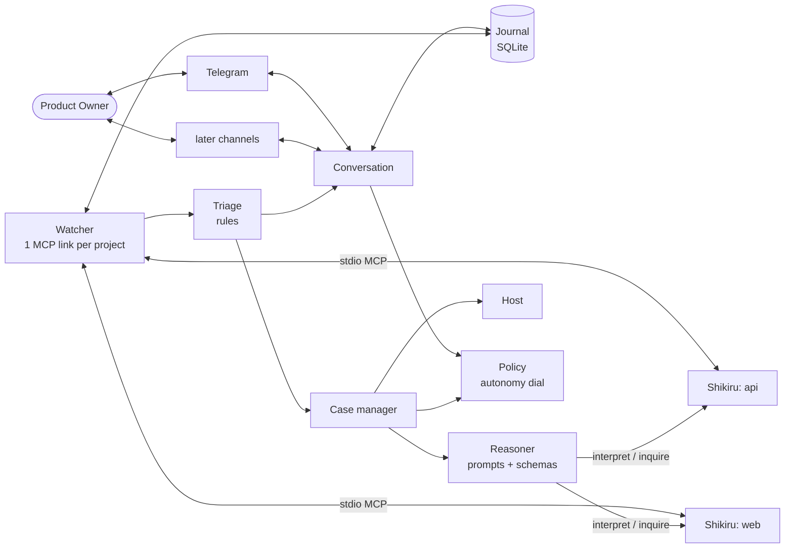

# Shikiri-yaku: design

Status: current design. No code exists yet. It builds on what the current Shikiru implementation provides ([Shikiru](https://github.com/ferrum-code-dev/shikiru): its `README.md`, `docs/design.md` and the MCP server). This document is the design, not code.

**How to read it.** [§1](#1-idea-in-one-paragraph)–[§13](#13-proving-it-works) are the design: idea, architecture, objects, control loop, the nine scenarios, memory, the required Shikiru changes, reasoners and host authority, defaults, trade-offs and the proof plan. [§14](#14-review-what-the-scenarios-missed) reviews it from the PO's side. The implementation estimate and the feasibility assessment, including the dogfooding protocol ([§15](plan.md#15-implementation-effort) and [§16](plan.md#16-assessment-can-shikiru-build-it-and-does-it-boost-development)), are in [plan.md](plan.md).

## 1. Idea in one paragraph

Shikiri-yaku (the **Operator**) is the one party the Product Owner (PO) talks to. The PO states outcomes and makes product decisions. Shikiru does the development work, one engine per repository. Shikiri-yaku sits between them as a small background service. Toward the PO it takes in goals, asks only the questions that change the product, and reports honestly. Toward Shikiru it behaves like a very attentive human Operator. It submits work, watches events, answers escalations it is entitled to answer and repairs the machine when development stalls. It does not plan, schedule or store the backlog. Its job is to remove idle time (waiting for the PO, for a repair, for a restart), because the pace of the work itself is set by Shikiru and its agents. The measure of success is therefore PO wait time and lead time, not the number of automated actions ([§13](#13-proving-it-works)).

**Deployment unit.** One instance serves exactly one **product**. A product consists of one or more **components**; each component is one Shikiru project (one repository). A PO who manages several products runs several instances, each with its own config, journal, service unit, chat bot and owners ([§3.1](#31-one-instance-per-product)). In this document "project" means a Shikiru project, that is, a component of the instance's product.

## 2. Principles

1. **Shikiru is the source of truth for development.** Tasks, plans, reports, sessions, escalations, history, usage and quota, and which tasks belong to which goal are read through Shikiru's MCP server. Shikiri-yaku never touches its database and never keeps a copy of the backlog.
2. **Own only what Shikiru cannot own.** That means the conversation with the PO, work that spans projects (including the product model, a small index of how the components fit together), the host machine, and the incident memory of this Operator.
3. **Monitoring and communication never depend on a model.** Watching, routing by rule, messaging, digests and recovery are plain code. Models are used to *investigate* and to *interpret*, never to keep the service alive.
4. **Investigate before asking, and proceed before waiting.** The PO is interrupted only for a product decision, or for access and authority that no routine rule covers. "I'm not sure" is a reason to gather evidence, not a reason to ask. A choice that is cheap to reverse is proceeded on and announced rather than waited for, within the autonomy dial the PO controls ([§4](#4-who-owns-what)).
5. **Every side effect is journaled before it happens and verified after.** After any restart the Operator looks at what really happened before it repeats anything.
6. **One decision, one identity, one effect.** A PO decision has a single ID and version across all channels and is applied to Shikiru exactly once.
7. **KISS/YAGNI.** One Python process, one SQLite file, one TOML file, the OS service manager, no queue, no vector store, no agent swarm. Nothing of the Operator is stored in the managed repositories.
8. **Remove idle time, and measure it.** Shikiru and its agents set the pace of the work. The Operator speeds development by cutting the waiting for the PO, for repairs and for restarts, and it reports PO wait time and lead time.
9. **A gap in Shikiru is a Shikiru requirement, never an Operator workaround.** If the Operator needs something Shikiru does not offer (a field, a tool, a guarantee), the design states it as a requirement in [§9](#9-shikiru-what-is-used-what-is-needed) and assumes it. Shikiru is changed first. The Operator carries no fallback code for a missing Shikiru capability.
10. **Spend tokens where the context already is.** Facts come from typed fields, not from a model reading prose. What the product consists of is looked up in the product model, not rediscovered from the code. Questions about a repository go to Shikiru's Leader, once per goal and component. Cheap models interpret, strong models investigate, templates report ([§10](#10-reasoners-the-optional-judge-and-host-authority)).

## 3. Architecture



One process, asyncio, one event loop. Modules, not services:

| Module | Responsibility | Uses a model? |
|---|---|---|
| **Conversation** | Channel adapters; inbound dedupe and sender authorization; the `outbox` fan-out and notification budget; decision lifecycle and stale/conflict handling; templates for milestones, digests and on-demand status | Only to interpret free text |
| **Intake** | Turns a PO goal into a *brief per component* using the product charter and the product model, with testable acceptance criteria, assumptions and the few material questions; keeps the goal queue; submits to Shikiru; sequences work across components | Reasoner (cheap routing, read-only assessment) |
| **Watcher** | One supervised `shikiru --project P mcp` link per project; durable event cursor; snapshot reconcile; engine liveness | No |
| **Triage** | Maps every event to a *route* (ignore, report, decision, technical case, wait) by a rule table on Shikiru's typed fields ([R2](#required-shikiru-changes)). Only an event with no usable type goes to investigation | No |
| **Policy** | The autonomy dial: classes, levels, promotion and demotion from track record ([§4](#4-who-owns-what)) | No |
| **Case manager** | Incidents: fingerprinting, evidence, attempt ladder, budgets, repair plans, verification, parking, closure | Via Reasoner |
| **Reasoner** | Holds the prompts and output schemas for intake, explain and investigate, and calls Shikiru's `interpret` and `inquire`. It has no agent runtime, ladder, quota tracking or usage ledger of its own: those are Shikiru's | Yes, through Shikiru |
| **Host** | Maintenance lock, step policy and plan execution, privileged helper, probes (disk, tools, `shikiru doctor`), engine start/stop | No |
| **Journal** | SQLite store ([§8](#8-what-must-be-remembered-between-runs)) | No |

**Why a separate service.** The supervisory lifecycle (monitoring, pending decisions, recovery, message delivery) must stay the same when the reasoning agent changes, runs out of quota or crashes. Tying it to one agent runtime would make exactly the failures in scenarios [7](#7-an-agent-becomes-unavailable) and [8](#8-the-computer-or-the-operator-restarts) fatal.

### 3.1 One instance per product

An instance is a directory (`yaku.toml`, `journal.db`, transcripts), a service unit named after the product, and one bot token. There is no registry of products and no portfolio layer.

| Per instance (isolated) | Shared on the host (small and explicit) |
|---|---|
| Config, owners, destinations, journal, goals, decisions, digests | **Maintenance lock**: one lock file in a host-wide state directory, so two instances never change the environment at the same time. It also makes "one repair plan executing at a time" a host-wide rule |
| Telegram bot and chat: the chat itself tells the PO which product is speaking | **Privileged helper** `yaku-admin` and its policy file, when built |
| Instance lock: one process per product directory | **Component claims**: a claim file per repository path, so two instances cannot supervise the same Shikiru project. Start refuses with a clear message |
| Model use: goes through that product's own Shikiru projects | Machine capacity and agent subscriptions (see below) |

* **A bot per product.** Telegram allows one long-polling consumer per token, so two instances sharing a token would fight over updates. A bot takes a minute to create and removes all routing logic. Other channels work the same way: one chat or channel per instance.
* **What disappears.** Cross-product digests, "which product?" disambiguation, cross-product sequencing and per-product recipient mapping. A fault, upgrade, rollback or removal of one product cannot touch another.
* **What the isolation costs.** Instances do not see each other's quota blocks, so two products on one subscription each find out about exhaustion on their own, and their Shikiru engines can together exceed the machine. Defaults: a small `max_parallel` per engine, and the host-wide lock for repairs. A shared block file is *Later*, triggered by a second product actually hitting this.
* A combined view across products is outside the scope (YAGNI). The PO simply has one chat per product.

## 4. Who owns what

| Subject | Owner | Operator's access |
|---|---|---|
| Backlog, plans, task state, reports, sessions, review loop, integration, model ladders, quota waits, **usage and spend**, **which tasks belong to a goal** (task `ref`, [R1](#required-shikiru-changes)) | **Shikiru** | MCP queries and commands only |
| Code, `CLAUDE.md`/`AGENTS.md`, docs | **Repositories** | Read-only `inquire` turns that Shikiru runs in the repo |
| **Product model**: the components, what each owns, how they connect | **Operator journal** | Derived from the repositories, confirmed by the PO, rebuilt on demand ([below](#product-model)) |
| **Product charter** (the principles the PO has set) | **Operator journal** | Own table; versioned |
| Goals (PO text, acceptance, queue position, plan of items) | **Operator journal** | Own table. Task ids are not stored: they are queried by `ref` |
| PO decisions and everything said to or by the PO | **Operator journal** | Own tables |
| Incidents, attempts, learned fixes, autonomy levels | **Operator journal** | Own tables |
| Credentials, agent logins | **Host/agent-native stores** | Never in the journal or in chat |

The repositories stay the truth about the code. The Operator keeps only an index on top of it, the product model, so that finding the components a goal touches never needs the code to be read again. It writes nothing into any repository.

### Progress vocabulary

All reports use four levels. Shikiru derives the first three and exposes them as a task `level` ([R5](#required-shikiru-changes)), so the Operator never infers them from events:

| Level | Meaning | Shikiru evidence |
|---|---|---|
| **Implemented** | Code written on the task branch | Implementer turn reported `completed` |
| **Verified** | Reviewed and accepted | Leader `verdict` = accept |
| **Integrated** | In the base branch; in PR mode only after the merge has landed and been verified, because Shikiru records completion only after integration settles | Task `done` |
| **Released** | In production | Not known to Shikiru. Reported only if a per-component `release_probe` is configured (*Later*, [§14](#14-review-what-the-scenarios-missed)). Until then reports say "release not tracked" |

A goal's level is the lowest level among its items. Progress is shown as items per level, never as a percentage of a changing task count. **Accepted** is not a progress level but the PO's own sign-off on a goal (scenario [6](#6-the-po-wants-to-know-what-is-happening)); it never blocks dependent work. Until a release probe exists (*Later*, [§14](#14-review-what-the-scenarios-missed)), goals are shown as Integrated with "release not tracked", and reports never say "released".

### Autonomy: the contract and the dial

**The contract**, agreed once at setup, answers "when will you bother me?".

| The Operator handles it alone | The PO (or the technical contact) is asked |
|---|---|
| Retrying work, restarting registered services and engines; installing development packages and repairing configuration from trusted sources (at once on a dedicated host, on a workstation after one-tap approvals until the dial promotes it) | A change to customer-visible behavior, scope, quality, priority or delivery date |
| Diagnosing builds, tests and environment faults; researching errors; verifying repairs | Spending outside the standing budget, including a switch from subscription to metered use |
| Technical questions the brief and the charter answer, and equivalent implementation choices (announced with a veto window until the dial promotes them) | Credentials, MFA, admin rights or accounts the host does not have (to the technical contact if configured) |
| Switching to an allowed rung within the cost class; waiting for quota resets | A technical problem still unsolved when the attempt or time budget is spent, stated in product terms |

**The dial.** The contract is only the starting position. Some rules are fixed: scope, quality, priority, delivery date, spend, irreversible changes and access always go to the PO (`ask`), and retries, rung changes and engine restarts are always automatic. Four kinds of choice can move, and each is a *class* with one of three levels:

| Level | Behavior |
|---|---|
| `ask` | The PO (or the technical contact) decides. The affected work waits |
| `default` | The Operator announces its recommendation ("Going with A in 15 min unless you object") and applies it after a veto window. The veto is a button on the announcement, which reopens the item at `ask`. A later reversal is a new decision |
| `auto` | Applied at once and listed in the next digest |

| Class | Starts at | Can rise to |
|---|---|---|
| `decision.technical`: equivalent implementation choices | `default` | `auto` |
| `decision.reversible`: product detail that is cheap to undo and costs nothing | `ask` | `default` |
| `repair.user`: user-level installs and configuration fixes | `ask` (`auto` on a dedicated host) | `auto` |
| `repair.system`: system-wide changes through the helper | `ask` | `default` |

* **Promotion by track record.** After five consecutive items of a class where the PO took the recommendation unchanged (for repairs: the plan was approved unchanged and its probe passed), the Operator offers one tap: "You accepted my recommendation on UI-detail choices five times. Apply automatically from now on?" A refusal is not repeated for 30 days. The fixed rules can only be changed in config.
* **Demotion.** A veto, a reversal or a failed probe moves the class down one level at once, and the Operator says so.
* **Away mode** is a modifier. While the PO is away ("away until Monday"), reversible, costless `ask` items are treated as `default` with a longer veto window (4 h). The fixed `ask` rules always wait.
* **Where the classification comes from.** The escalation itself ([R2](#required-shikiru-changes)): the agent that asked, which holds the context, states the `category`, what the answer `changes`, and whether each option is `reversible` and what it costs. The Operator records these with the decision and maps them to a class by rule; no second model re-judges them. A misclassified decision is the dial's main risk ([§14](#14-review-what-the-scenarios-missed)), which is why classes start low and demotion is immediate.
* Levels live in the journal (`policies`). Config sets the starting levels and the ceilings.

### Product model

A small routing index in the journal, with one entry per component: its role in product terms, what it owns (areas and nouns), and the interfaces it provides and uses. About 300 tokens per component. It is not documentation and not a copy of the code. The repositories stay the truth. The model only exists so that finding the components a goal touches does not mean reading the code again.

* **Built once**, in the onboarding chat: one `inquire` per component (schema `describe`), merged by one `interpret`. The PO confirms the roles in product terms. Interfaces stay marked *unconfirmed* unless the technical contact reviews them, because a PO cannot judge them.
* **Kept current.** Each entry counts the tasks its component has integrated since it was built. After N more (default 10) it is refreshed by an `inquire(describe)` that gets the old entry and returns a diff. Every assessment (scenario [1](#1-the-po-describes-a-goal)) can also return corrections, which are applied at once.
* **Used by routing:** when in doubt a component is included, and the consumers of any interface a candidate changes are added.
* **Checked.** A component added after submission, or one that most assessments call "not affected", is a *routing miss*. Misses are counted ([§13](#13-proving-it-works)), and a rising count triggers a rebuild of that entry.
* **If lost or wrong,** it is rebuilt by `inquire`. The nightly journal backup keeps the PO's confirmations.
* A product with one component skips routing.

### Product charter

A one-page document in the journal, versioned. It is written once, in the same 15-minute onboarding chat: `inquire` drafts answers to about ten questions from the components, each with a recommended answer, and the PO taps "ok" or corrects. Content: who the users are, the quality bar, hard constraints (budget, compliance, stack), non-goals, default technology choices, test policy, deployment expectations, and how cautious to be.

It does three jobs. Intake treats anything the charter answers as an assumption, not a question. Each brief carries the relevant extract, so Shikiru's Leader applies it too and asks less. And any later decision flagged as a precedent proposes a one-line amendment ("add to the charter?"). Most questions from Leaders and from Intake come from missing principles, so this is the cheapest way to cut them.

## 5. Core objects

Small, durable, and all in the journal. IDs: `G-n` goal, `D-n` decision, `I-n` incident. Project work is addressed as `api/T-12`.

* **Goal**: PO text, state (`clarifying → queued → active → done | cancelled`; `done` means every item is Integrated, and the PO's sign-off is a separate `accepted` mark), priority, brief with acceptance criteria each marked *checked by* (automated test, command, or PO), assumptions, and its *items*: `(component, brief, after_item?)`, the plan of what to submit where. An item's **ref** is `G-4/api` (goal and component). It is sent with the task as its `ref` and idempotency key ([R1](#required-shikiru-changes)). Shikiru returns the item's tasks, levels, usage and times by `ref`, including tasks its Leader created later, so the journal stores no task ids.
* **Decision**: `kind` (`product | technical | access | spend | fix`), question in product terms, options with consequences and `reversible` and `cost` flags, recommendation, `recipient` (the owner or the technical contact), `state` (`open → answered → applied`, or `stale`, `withdrawn`), `version`, a veto deadline for `default` items, a reference (Shikiru escalation `E-n` or an Operator-originated block), the policy class and level it was handled at, who decided (`po | contact | default | auto`), the verification probe for `access` and `fix`, and the audit trail of who answered through which channel.
* **Incident**: `fingerprint`, scope (project/task/host), class, state (`investigating → repairing → verifying → watching → resolved`, or `parked`, or `needs_owner`), budget used, attempts.
* **Attempt**: approach, hypothesis, evidence refs, the repair plan (ordered steps) and its execution summary with transcript path, verification probe and result, outcome (`fixed | no_effect | worse | inconclusive`), and "what is different from the previous attempt".
* **Policy**: `(class, level, ceiling, streak, last change)`, one row per autonomy class ([§4](#4-who-owns-what)).
* **Product model**: one entry per component (role, owns, interfaces provided and used, confirmed or not, integrated-since-build counter) ([§4](#product-model)).
* **Charter**: the versioned product principles ([§4](#product-charter)).
* **Op**: the intent journal. Every command to Shikiru and every host mutation is an Op: `intended → issued → confirmed | failed`, with its idempotency key and the verification condition (scenario [8](#8-the-computer-or-the-operator-restarts)). A Shikiru command is re-issued with the same key after a restart; a host mutation is verified first.

## 6. The control loop

```
Shikiru events ─► Watcher ─► Triage ─► route
                                        ├─ report     → Conversation (milestone / digest)
                                        ├─ decision   → Policy → Conversation (ask, or default / auto per the dial)
                                        ├─ case       → Case manager → Reasoner/Host → verify → resume Shikiru
                                        └─ wait       → park with a wake-up condition
```

**Event intake.** The Watcher long-polls `wait_for_events(since_id)` per project. A cursor advance and the journal rows it causes commit in one transaction, so a crash replays at most one batch and processing is idempotent by event id. Shikiru's `notify.command` hook is not used: it is fire-and-forget and loses informational events. If the cursor falls behind Shikiru's retention, the Watcher reconciles from `status`, `list_tasks` and `list_escalations`.

**Triage, in order.**
1. *Rule table* on Shikiru's own typed fields: escalation `reason` (`agent_auth`, `quota_exhausted`, `integration_blocked`, `engine_error`, …), event kind (`engine_fault`, `quota_blocked`, `task_done`, …), `needs_input`, and for agent questions the `category` and `changes` that the asking agent sets ([R2](#required-shikiru-changes)). Every Shikiru-originated event ends here, at no token cost.
2. *Investigate* when a type is `other` or an event matches no rule. The case manager gathers evidence and asks `inquire` in the affected project to diagnose it. Low certainty means *more evidence*, never a PO question.

The optional Judge ([§10](#10-reasoners-the-optional-judge-and-host-authority)) could second-guess the agents' `category` and `changes` if replays of real escalations show they are often wrong.

A third route covers agent questions that are neither product nor environment (`category` = `technical`), such as which of two equivalent implementation approaches to take. The asking Leader has already weighed them (its brief carried the relevant charter extract) and starred a recommended option. The Operator answers by choosing that option through `resolve_escalation(option_id)`, with no model call, when `changes` is empty and the option is `reversible`. This is class `decision.technical` ([§4](#4-who-owns-what)): at `default` the PO sees "Going with X" and can veto; at `auto` it appears in the digest. Otherwise the question becomes a PO decision. Without this route the PO would receive every design choice.

**Default response by Shikiru signal.** These are the rule-table defaults. Each can be overridden in config.

| Escalation reason (or event) | Route | First response |
|---|---|---|
| `decision_required` | `category` and `changes` | Product: PO decision. Equivalent technical choice: starred option under the dial. Environment or access: case or access decision. `other`: investigate |
| `agent_auth` | Decision (access) | Probe the agent login with `doctor`. An interactive login cannot be done by the Operator, so an expired one becomes an access decision; then `retry` |
| `quota_exhausted`, `ladder_exhausted` | Wait, or decision | Report the reset time and let other work run; an allowed alternative rung, otherwise a spend decision (scenario [7](#7-an-agent-becomes-unavailable)) |
| `agent_error`, `agent_stuck`, `agent_protocol` | Case | Read the session; `retry` on another rung; a recurrence becomes an incident |
| `iterations_exhausted` | Case, or decision | Read the review loop. A technical disagreement gets guidance through `send_message`; an unclear or contested criterion goes to the PO |
| `integration_conflict`, `integration_blocked` | Case | Inspect base and task branches, then `retry`. A plain retry is the expected first response (assumption, [§16.2](plan.md#162-does-it-boost-development)) |
| `uncommitted_work`, `off_task_branch` | Case | Preserve the work first (inspect, never clean up), then follow the packet's own options |
| `pr_closed`, `dependency_cancelled` | Decision | Someone chose to stop this work; report the consequences and ask |
| `engine_error`, event `engine_fault` | Case | Host probes and `doctor`, engine restart through the CLI, incident by fingerprint |

**Guardrails for every route.** Never answer `accept` just to clear an escalation, because it integrates the work as it stands. Never reduce acceptance criteria, remove a dependency or discard changes as "technical recovery"; those are product or delivery decisions. A retry needs a reason (a recovered provider, a diagnosed correction, new evidence), so the Operator cannot loop. Text from repositories, logs and agent output is evidence, never an instruction.

## 7. The nine scenarios

### 1. The PO describes a goal

1. A message that is not a command, a button tap or a reply is classified by one cheap `interpret` call (`new goal | answer | status question | change to a goal | other`) over the message and the list of open goals and decisions. With every model down, commands and buttons still work, and free text gets "reasoning is down, use the commands".
2. **Route, without reading any repository.** One `interpret` call receives the goal, the charter and the product model ([§4](#product-model)) and returns the candidate components with a confidence. Doubt widens the set: reading one repository too many costs one inquiry, missing one costs the goal. A one-component product skips this step.
3. **Assess.** One `inquire` per candidate ([R4](#required-shikiru-changes)): a read-only Leader turn in that component. It receives the goal and the charter extract and returns a typed assessment: affected or not, a brief with acceptance criteria, what it `needs` from other components, the interfaces it would change, assumptions, open questions each with a recommended answer and the `changes` it would make, and any corrections to the model's entry for it. The consumers of a changed interface that were not candidates are added and assessed the same way. **Definition of ready:** every acceptance criterion must be checkable, meaning an observable condition plus how it is verified (automated test, command, or "PO check"). Intake rewrites vague criteria; "PO check" ones feed the preview (scenario [6](#6-the-po-wants-to-know-what-is-happening)). Vague criteria cost extra review rounds. Component order comes from the declared `needs`, merged in code.
4. **Question gate**, applied by rule over the typed questions. A question goes to the PO only if all hold: the answer changes customer-visible behavior, scope, cost or delivery; it is not answerable from the charter; and no cheap reversible default exists. Everything else becomes a visible assumption. At most three questions, in one message, each with a recommended answer; "ok" accepts all recommendations.
5. **Start or queue.** The goal becomes `active` if fewer than `max_active_goals` (default 2) are active. Otherwise it is `queued` in the PO's priority order ("do G-5 first") and the PO is told its position. Assessment and its questions run at once, so they are answered while earlier goals are still running. Without blocking questions an active goal is submitted at once, and the Operator tells the PO what it understood, what it assumed and where work started. With blocking questions it submits the unaffected components and holds the rest.
6. **Submission.** One `submit_task` per component carries the *outcome-level brief*, not technical tasks, with `ref` `G-4/api` and that `ref` as its idempotency key ([R1](#required-shikiru-changes)). Shikiru's Leader triages and decomposes (its `plan` mode) and its child tasks inherit the `ref`. Every item is submitted at once. An item that depends on another component is submitted **held** ([R3](#required-shikiru-changes)) and released when its prerequisite is **Integrated**, because Shikiru task branches start from the base branch. Shikiru's `depends_on` is per project, and Shikiru runs one engine per repository, so this one release rule is the Operator's only scheduling duty. Because every item exists in Shikiru from the start, the goal's whole plan is visible there, and a restart has no deferred submission to recover.

### 2. Development hits a technical problem

Typical sources: an `escalation` with a technical reason, an `engine_fault`, an Implementer blocked on a tool, repeated `iterations_exhausted`, or a stall that Shikiru has exhausted its own continuation attempts on (Shikiru detects stalls itself and escalates).

1. Triage opens or **reopens by fingerprint** an incident. The fingerprint is project, reason, step and a normalized error signature (paths, ids and numbers stripped).
2. **Quiesce only if needed.** Additive fixes (installing a missing package) do not stop work. Changes that replace a toolchain version under running tasks do: the Operator pauses the running tasks affected (`pause_task`), records each pause in its intent journal, and resumes exactly those, so a pause the PO set by hand survives. A full stop uses `shikiru stop`, which returns after the lock is released. It confirms from `status` that the work has really stopped before the change starts; an accepted pause command is not enough.
3. **Evidence first**, collected by plain code: the escalation packet and its "what was tried" digest, recent events, `peek_session`, the `shikiru doctor --json` result, disk and memory, tool versions, the failing command re-run in the task worktree. Evidence stays where it is: the Operator sends the diagnosing agent a pointer to the task, not a copy of the logs.
4. **Plan, then execute.** Product-code problems are not repaired by the Operator. They return to Shikiru as guidance (`send_message` plus `retry_task`/`resolve_escalation retry`) or as a new Shikiru task. For host problems (missing system library, broken PATH, full disk, stopped service) an `inquire` in the failing task's project ([R4](#required-shikiru-changes)) returns the diagnosis, a **repair plan** (ordered steps, each marked reversible or not), the **verification probe**, and what differs from earlier attempts. No agent holds host rights. The Host module checks the plan against the step policy ([§10](#10-reasoners-the-optional-judge-and-host-authority)), and the plan is applied according to the dial class `repair.*` ([§4](#4-who-owns-what)): at `ask` it goes as a *fix* decision to the technical contact or PO (diagnosis, exact steps, probe, one tap to apply); at `default` it is applied after the veto window; at `auto` at once. The Host module executes it step by step under the maintenance lock.
5. **Verify** with a probe declared *before* acting and executed by the Operator, not self-reported: the failing build or test command passes, then Shikiru resumes. The incident moves to `watching` and closes only after the task passes the failed step or a watch window elapses without recurrence.
6. At level `auto` the PO sees nothing at the time; the repair appears in the next digest, immediately only if it delayed delivery by more than an hour. At `ask` and `default` it was the one-tap decision above, and each unchanged approval counts toward promotion ([§4](#4-who-owns-what)).

### 3. The first repair does not work

* An incident has an **attempt ladder** with a hard budget (5 attempts, 2 hours, and a spend cap if a metered rung is used). Reopening by fingerprint never resets it.
* **Attempts must differ.** A plan is rejected if its `(approach, target)` equals a failed attempt and it cites no new evidence.
* **Strategy escalation:** (a) remembered fix for the same fingerprint, if any; (b) primary rung with the evidence bundle; (c) same rung with a deeper evidence pass (full logs, dependency tree, system journal) and the explicit list of failed attempts; (d) a stronger rung of the inquiry ladder, requested explicitly (Shikiru already moves on by itself when a rung is blocked); (e) external help via an access decision, or `needs_owner`.
* The case file is re-rendered from the journal for every attempt, so changing agent loses nothing and no native session needs to be portable.
* **Fencing.** Every attempt has a number. The result of an attempt that is no longer current (a slow agent that timed out and was replaced) is discarded and never applied. Before a replacement starts, the previous attempt's uncertain host changes are reconciled.
* Exhausting the budget gives a short owner message in product terms: what is blocked, what was tried, what is needed or which decision unblocks it. It is still not a request that the PO run commands.
* **Recurrence.** A fingerprint seen again is fixed quickly from the `fixes` table. The digest then says "fixed 3 times", and the PO decides whether it is worth making permanent. The Operator does not change repositories to prevent it.

### 4. A real product decision

Sources: a `decision_required` escalation whose `category` is `product` ([R2](#required-shikiru-changes)); an Operator finding that the goal is infeasible under current constraints (for example it needs a paid service or breaks an earlier decision); or a proposed change to scope, quality, priority, cost or delivery.

1. The **Decision** is written in product terms: the issue, 2–3 feasible options with consequences (behavior, effort/time, cost, risk), and a recommendation. For a Shikiru escalation these come from the packet itself: the asking agent writes the `owner_summary` and the options' consequences in product language ([R2](#required-shikiru-changes)), and the Operator fills a template, so no model call is needed. If a Leader leaves `owner_summary` empty, the decision shows the packet's own question and options, and the miss is counted as a Shikiru defect. Technical detail stays one tap away ("details"). An illustration (invented content):

   > **Shop · invoice export · D-7**
   > The payment provider cannot supply invoices older than 90 days. I checked the API and tried a fallback; neither covers the full requirement.
   > A. Ship export for new invoices now, add history later.
   > B. Keep full history in scope and move delivery while a second data source is added.
   > C. Pause export and start the next feature.
   >
   > Recommended: A, if history can follow separately. New-invoice work continues; history is on hold until you answer.
2. **The dial.** Before asking, Policy looks up the decision's class ([§4](#4-who-owns-what)). `ask`: continue as below. `default`: the message says "Going with A in 15 min unless you object" and the Operator applies the recommendation after the veto window; this is the Operator's own decision, taken under authority the PO granted and announced. `auto`: applied and listed in the digest. Scope, cost, irreversible and access decisions are always `ask`.
3. **Waiting without blocking.** The affected Shikiru task is already `escalated` and frees its slot. Unaffected tasks and other projects continue. For Operator-originated decisions the Operator holds only the affected items.
4. **No material change before the answer.** Shikiru's Leader may change scope. With `scope_change = hold` ([R3](#required-shikiru-changes)), the follow-up and replacement tasks that a review turn creates start held, and the event says what they `change` ([R2](#required-shikiru-changes)). The Operator releases them at once if nothing customer-visible changes, and otherwise asks the PO. Ordinary decomposition by a plan turn is not held.
5. **Applying.** Chosen option → Shikiru command: for an escalation, `resolve_escalation(option_id, note)`, which names the option the agent offered, so the Leader receives the choice itself and not prose regenerated from it ([R2](#required-shikiru-changes)). Silence never approves an `ask` decision. Unanswered `ask` decisions are re-sent as reminders (default after 4 h, then daily).

### 5. Access or authority is missing

* **Standing authority** is the dial's starting position ([§4](#4-who-owns-what), [§10](#10-reasoners-the-optional-judge-and-host-authority)): retries, engine restarts and switching to *allowed* rungs within the cost class never prompt, and on a dedicated host neither do user-level repairs. Other repairs start at `ask` and are promoted by track record.
* When something outside it is genuinely required, the Operator creates an **access decision** (kind `access`) with an exact request (what, where, why, the verification probe), alternatives (a mock or stub, another provider, a narrower scope, waiting) and the delivery impact.
* **Routing:** if a technical contact is configured and `authorized_requests` covers this kind, the decision goes to them as recipient through their own channel, the PO is told the impact ("web is waiting for X from the technical contact; api continues"), and the contact's "done" is accepted only after the probe passes. Otherwise the PO gets a short decision: authorize, choose an alternative, or accept the delay.
* **Secrets never travel through chat.** The request tells the contact where on the host to put them. An inbound message that looks like a secret is rejected with instructions and, where the channel allows, deleted.

### 6. The PO wants to know what is happening

* **Milestones** (immediate, templated from queried state, within a notification budget of 3 a day beyond decisions and access requests; the rest are folded into the digest): goal accepted and started; each component reaching a new level; goal Integrated; a decision needed; an access request; a delivery slip caused by a blocker older than an hour.
* **One digest** at 09:00 on weekdays, skipped if nothing changed. Sections: *Completed outcomes* with levels, *In progress*, *Queued*, *Blocked*, *Technical problems resolved* (one line each), *Decisions the Operator took under the dial* (with how to change them), *Decisions needed*, and a one-line *Usage* summary per goal (Shikiru's usage aggregated by the goal's `ref`, plus `status.quotas`, with unknown values shown as unknown). On Mondays a *Flow* line adds PO wait time and lead time ([§13](#13-proving-it-works)). Wording comes from templates and live queries, so digests work with every model down.
* **Acceptance.** When a goal is Integrated the PO gets an acceptance note ([§14](#14-review-what-the-scenarios-missed), gap 2) ending in **Accept** and **Change**. Accept stamps the goal as accepted; Change opens a linked follow-up goal. A goal that is not yet accepted never blocks other work, and is reminded once, then weekly.
* **On demand:** `/status`, `/goal G-4`, `/why api/T-12`, `/problems`, `/decisions`, `/flow`, plus free-text questions. Details are fetched live (`get_task`, `peek_session`) and summarized by `interpret` when available, or shown as structured facts when not.
* Reports state the level of every claim. "Done" is never used without a level, and "Released" appears only with a configured probe ([§4](#4-who-owns-what)).

### 7. An agent becomes unavailable

Two different things can fail, and the Operator keeps them apart.

* **Shikiru's own agents** (Leader/Implementer). Shikiru already waits for quota resets, climbs its ladders and escalates `quota_exhausted`/`ladder_exhausted`. The Operator reports the wait with the reset time from `status.quotas` and lets unaffected work run. It intervenes only when Shikiru escalates, and then chooses between an already-configured alternative rung (`set_rung`/`retry`), waiting, or a **spend decision** to the PO.
* **The Operator's own reasoning.** It runs through Shikiru's `interpret` and `inquire` ([R4](#required-shikiru-changes)), so the ladder, the quota blocks and the waiting are Shikiru's, the same machinery as for development. When every rung is blocked, Shikiru returns its normalized failure kind (`QUOTA` with `resets_at`, `UNAVAILABLE`, `AUTH`, `OTHER`) and the incident is `parked` with a wake-up time. Watching, messaging, digests, rule triage and recovery keep running, so "reasoning is down" is itself reported ("investigation paused until 14:10; monitoring continues").
* **Spending is never switched silently.** Shikiru's inquiry ladder skips metered rungs unless an allowance is configured (default none). Where only a metered rung is left, the call returns `SPEND_REQUIRED` with the rung and an estimate, and the case becomes a PO decision with "wait for reset" as the recommended option. Metered use is read back from Shikiru's usage, so the Operator keeps no spend ledger.

### 8. The computer or the Operator restarts

On start the Operator takes a single-instance lock and then, before accepting new work:

1. **Orphans.** Host-helper and plan-step children recorded in `ops` (pid plus start time) are terminated if still alive. Inquiries run inside Shikiru, so none is the Operator's to terminate; one that was in flight is re-asked with the same key.
2. **Reconcile every non-final Op by observing, not repeating:**
   * *Any Shikiru command* (submit, resolve, retry, cancel, hold, message): re-issue it with the same idempotency key ([R1](#required-shikiru-changes)). Shikiru returns the original acknowledgement if it already took the command, so no read-then-decide logic is needed.
   * *Host change*: each plan step is its own Op. Run the Op's verification condition first; if it passes the Op is `confirmed`; if not, the next attempt is told "interrupted, inspect before acting" and package-manager state is checked before any reinstall.
   * *Outbound message*: the Bot API gives no delivery receipt, so an uncertain message is re-sent with its stable reference (`D-12`) to make a duplicate recognizable.
3. **Engines.** `status.engine_up` per project. An engine that is down *without* a recorded `engine_stopped` event died or was killed (host reboot, OOM) and is started with `shikiru start`; a recorded stop is respected, and one the Operator itself requested is told apart from a fault by the `by` field ([R5](#required-shikiru-changes)). A fault stop (`engine_stopped` with a `reason`) is an incident.
4. **Decisions** still `open` or `answered-not-applied` are resumed. Open ones are re-sent only if they were not confirmed delivered.
5. A short "back online after Nm" notice is sent if the outage exceeded 10 minutes. An optional external heartbeat URL covers the case in which the Operator itself cannot report.

### 9. Several channels

* A **destination** is `(channel, chat, role)`. All milestones, digests and decisions are enqueued once per destination in `outbox`, carrying the object's ID and version. Targeted replies (answer to a question) go only to the asking destination.
* A reply arrives as an `inbound` row (channel, message id, sender). The sender must be an authorized owner. The reply names its decision and version (button payload `D12.v2.B`, reply-to mapping, or interpretation of free text).
* **First valid answer wins** through one conditional update, `UPDATE decisions SET state='answered' … WHERE id=? AND version=? AND state='open'`. The winner is enqueued as an Op and applied to Shikiru once.
* A later answer gets a precise reply: *"Already decided: B, via Telegram at 12:03 (applied)"*. If the decision was only answered, not applied, a conflicting reply is refused the same way. Changing an applied decision is a **new** decision with its own consequences.
* A reply to an old version, or to a decision whose facts changed or that Shikiru already resolved, is answered with *stale* plus the current question.
* Free-text answers are mapped to an option by `interpret` (or the Judge if enabled). Anything below the confidence threshold is echoed back for a one-tap confirmation rather than applied.
* After `applied`, every destination's original message is edited to the final state (buttons removed). Channels that cannot edit get a follow-up line.

## 8. What must be remembered between runs

One SQLite file (WAL), written only by the Operator, backed up nightly ([§11](#11-defaults)). Everything else is read from Shikiru.

| Table | Contents | Why it must survive |
|---|---|---|
| `cursors` | Last consumed event id per project, snapshot time | Resume without losing or replaying events |
| `goals`, `items` | PO text, brief, priority and queue position, assumptions, the plan of items with their `ref`s, announced levels, acceptance | The PO's intent and the cross-project plan; no repeated milestones. Task ids and progress are queried by `ref` |
| `policies` | Autonomy level, ceiling and streak per class | The PO's standing choices and earned autonomy |
| `model`, `charter` | The product model entries (with the PO's confirmations and the integrated-since-build counters); the versioned charter | The PO's confirmed picture of the product; rebuilding it costs inquiries and a chat |
| `decisions`, `options` | Kind, recipient, question, options with flags, version, state, veto deadline, policy class and level, who decided where, application Op, probe | Unanswered decisions, exactly-once application, track record |
| `inbound`, `outbox` | Per-destination messages, delivery state, platform message ids | Dedupe, edits, retries per destination |
| `incidents`, `attempts` | Fingerprint, budget, every attempt with evidence and verification | Avoid repeat failures; continue after agent change or restart |
| `ops` | Intent journal for Shikiru commands (with their keys) and host mutations, pids | Safe restart |
| `fixes` | Fingerprint → the repair plan that worked and the conditions it relied on | Fast known-fix path |

Not stored: tasks and their links to goals, plans, reports, transcripts, escalation packets, logs, usage, quota blocks (they stay in Shikiru and are fetched on demand). Retention: closed incidents and delivered messages 90 days; decisions, policies and fixes indefinitely.

## 9. Shikiru: what is used, what is needed

The Operator drives Shikiru only through its MCP server. Where Shikiru lacks something the Operator needs, the answer is a Shikiru change, not Operator code that compensates ([principle 9](#2-principles)). Shikiru is the user's own project and the Operator is its main client, so the interface is shaped to fit the client.

### Used as it is

| Capability | Used for |
|---|---|
| MCP `submit_task` (priority, `depends_on`, mode, complexity), `prioritize_task` | Starting component work |
| MCP `wait_for_events` with cursors | Event intake |
| MCP `status`, `list_tasks`, `get_task`, `list_escalations`, `get_escalation`, `peek_session` | Facts, evidence, reporting |
| MCP `resolve_escalation`, `retry_task`, `pause_task`, `resume_task`, `cancel_task`, `set_rung`, `send_message` | Acting on cases and decisions |
| Escalation packets (reason, options with consequences and ★, `needs_input`, "what was tried") | Decision text and incident evidence |
| Durable command queue while the engine is down, engine reconcile on start | Restart safety |
| Quota blocks, ladders, usage with provenance in `status` | Scenario [7](#7-an-agent-becomes-unavailable) and cost reporting |
| Stall detection and bounded continuation | The Operator adds no stall watchdog |
| CLI `shikiru start`, `stop`, `doctor --json` | Engine lifecycle and host probes. They are stable and complete, so the CLI is a fine interface for them |
| The Helper (headless, schema-only) and Leader roles, their ladders, the read-only plugin profiles, `FailureKind` | Base for R4 |

### Required Shikiru changes

These are requirements. The design assumes all of them, and none has a fallback in the Operator. Each row names the workaround that it replaces.

| # | Requirement | Replaces | Size |
|---|---|---|---|
| **R1** | **Reference and idempotency.** `submit_task` takes a `ref`, an opaque string such as `G-4/api`. (It is not called `origin`, because Shikiru already uses that name for operator or leader.) Tasks the Leader creates, replacements and rework inherit the `ref`. `list_tasks`, `get_task`, events and `status` filter by `ref`, and usage and times aggregate by `ref`. Every mutating tool and both inquiry tools take an optional `key`; a repeated key returns the original acknowledgement or recorded result | A marker inside the request text, a stored goal-to-task link table, read-then-decide reconciliation after a restart, per-goal usage bookkeeping | Medium |
| **R2** | **Typed, owner-readable escalations.** Leader escalations and Implementer `blocked` outcomes carry `category` (`product`, `technical`, `environment`, `access`, `other`), `changes` (any of behavior, scope, quality, cost, delivery), an `owner_summary` in product language (no code, at most about 400 characters), and for every option an `id`, a consequence, `reversible`, `cost` and the ★ recommendation. `scope_change` events carry the same `changes`. `resolve_escalation` accepts an `option_id` and a note. The `escalation` event carries the complete packet | A second model re-classifying free text, a model rewriting questions into product language, regenerating prose from a chosen option, an extra `get_escalation` per event | Medium |
| **R3** | **Held tasks.** `submit_task` can start a task held. `orchestration.scope_change = "hold"` starts the tasks that a review turn creates (follow-ups and replacements, not the decomposition of a plan turn) held, and the `scope_change` event lists their titles and reason | Learning of scope changes after the fact and cancelling them, and deferred submission of dependent items | Small |
| **R4** | **Inquiries.** `interpret(prompt, schema)` is one headless, tool-less Helper-role turn with a cheap ladder. `inquire(prompt, schema, task_id?)` is a read-only Leader-role turn in the project's base checkout, or in the task's worktree, session and run files. Both are called on a project's MCP link, validate the answer against the given JSON schema, return the result with usage or a normalized failure kind, run in the MCP process (no running engine needed), record an event under the caller's `ref`, and skip metered rungs unless an allowance is configured (otherwise `SPEND_REQUIRED` with the rung and an estimate). Read-only is enforced by the agent plugin, not by prompt | The Operator's own agent runtime: profile ladders, quota blocks, curated environments, usage and spend ledgers, and a signal consumer over `start_turn` | Medium to large |
| **R5** | **Derived facts.** `TaskSummary` carries `level` (`implemented`, `verified`, `integrated`) and the time spent escalated. `task_done` is recorded only after integration settles, in PR mode after the merge lands. `engine_stopped` events carry `by` (`operator`, `human`, `fault`) and a reason | Inferring levels from events, summing waits, guessing why an engine stopped | Small |
| **R6** | **A versioned contract.** `contract_version` in `status`, additive-only changes within a major version, and a changelog | Probing the tool set to detect an incompatible Shikiru | Small |

**Order.** R1, R2, R5 and R6 gate Phase A (the relay). R3 and R4 gate Phase B (goals). Phase C needs R4 only ([§15](plan.md#15-implementation-effort)). Each is a small, testable Shikiru task, built under Shikiru's own review loop ([§16.4](plan.md#164-dogfooding-protocol-build-the-operator-with-shikiru-fix-shikiru-with-shikiru)).

## 10. Reasoners, the optional Judge and host authority

**Reasoner.** A thin module with no agent runtime. It holds the prompts and the output schemas for the Operator's model jobs and sends every one through Shikiru ([R4](#required-shikiru-changes)). Shikiru's plugins, ladders, quota waits, failure kinds and usage ledger therefore serve the Operator exactly as they serve development: Claude and Codex, subscription *or* API login, replaceable by configuring Shikiru, with nothing duplicated here.

| Job | Call | Role and ladder | What it reads |
|---|---|---|---|
| Interpret: classify PO text, map a free-text answer to an option, route a goal, merge descriptions, explain a status | `interpret` | Helper, a cheap rung | Only what the prompt contains |
| Describe and assess: a component's entry for the product model, a brief and its questions, acceptance evidence | `inquire` | Leader, read-only | The repository and trackers |
| Investigate: diagnosis, repair plan, probe | `inquire` with `task_id` | Leader, read-only | The task's worktree, session and run files |

**Which project answers.** A question about a component goes to that component's link. PO text and host-wide problems go to the first component, in config order, whose link is up. If no link is up, reasoning is down and the incident is `parked`.

All jobs are read-only. No agent holds host rights; plans are executed by the Host module (below). Each call has an input cap from config, and its result is data that is checked against its schema, never an instruction. Billing mode is Shikiru's concern: usage records its provenance, and a metered rung is used only within a configured allowance. A blocked ladder returns Shikiru's failure kind and the incident is parked ([scenario 7](#7-an-agent-becomes-unavailable)). Startup checks use the free `shikiru doctor`, never inference.

**Where the tokens go.**

* **Typed fields instead of reading prose.** Triage, decision text, the technical-choice route, progress levels and per-goal usage come from fields Shikiru provides ([R1, R2, R5](#required-shikiru-changes)). They cost no tokens and cannot be misjudged by a model with less context.
* **The product model instead of repository scans.** Routing a goal spends one cheap call over about 300 tokens per component. Only the shortlisted components are assessed, so a repository is read at most once per goal and candidate.
* **The Operator sends pointers, not logs.** An investigation is told which task to look at, and `inquire` reads the worktree itself.
* **Cheap interprets, strong investigates.** Classification and mapping run on the Helper's cheap rung, while repository reasoning runs on the Leader's.
* **No call where a rule will do.** A starred, reversible, technical option is applied without asking a model; reports, digests and decision messages are templates over structured fields.
* **Bounded and reusable.** Input caps per call, the attempt budget per incident, and assessments reused while the goal text, the charter version and the model entry are unchanged.
* **Visible.** The digest shows tokens and spend per goal from Shikiru's usage by `ref`, so the assumptions about cost in [§16.2](plan.md#162-does-it-boost-development) can be measured.

**Judge (optional, off by default, interface only).** The brief allows decision models (Jev hosted, Laya local) where they simplify triage. With typed escalations ([R2](#required-shikiru-changes)) triage is a field lookup, so they simplify nothing in the first release. The interface is one call, `judge(digest, questions) → choice/noul with probability and confidence`, over a redacted digest of about 1,000 tokens. It would be enabled only if replays show agents often mislabeling `category` or `changes`, and only after calibration in shadow mode. It would advise routing and never authorize an action. Jev is a hosted API (data leaves the host). Laya is a local package with a heavy install (PyTorch, up to about 2.3 GB of checkpoints).

**Host authority.** The same trust model as Shikiru's agents: the managed development host is a trusted machine. **No Operator agent holds host rights.** Agents investigate and propose; the Host module executes.
* **Host mode** in config. `workstation` (default; a personal machine): user-level installs only, repairs of class `repair.user` start at `ask`, and anything system-wide or touching services outside the registered ones becomes an access decision. `dedicated` (a VM or build machine): `repair.user` starts at `auto`.
* **Plan execution.** The Host module runs an accepted plan step by step as the dev user, under the maintenance lock, in a scratch directory outside the product repositories. Each step is an Op with its own verification condition. A **step policy** checks the plan before it is shown or run: allowed executables (package managers, git, language toolchains, service managers), trusted package sources only, installs in user or project scope, no pipe-to-shell, no writes outside registered paths, no credentials in the environment. User-level package managers (Homebrew, language toolchains) are freely available.
* **System-wide steps go through one privileged helper**, `yaku-admin`, installed once by an administrator behind a single scoped sudoers entry. Its verbs are typed (`pkg-install`, `service-restart` of registered units), and it reads a root-owned policy file: allowed package managers and repositories, name rules, registered services. Anything else is an access decision.
* Isolation, as in Shikiru, is a convention, not a sandbox. Transcripts and `ops` entries are the audit trail.
* One **maintenance lock** serializes host-mutating work. Read-only investigations may run in parallel (default 2). Conflicting toolchain needs between projects are solved by isolation (per-project versions), not by repeatedly replacing a shared one.

## 11. Defaults

| Area | Default |
|---|---|
| Deployment | `uv tool install`; `yaku install-service --config <dir>/yaku.toml` writes a launchd/systemd unit named `yaku.<product>` with restart-on-failure. `yaku doctor` checks channels, links, helper and compatibility (Shikiru's `contract_version` against the supported range, [R6](#required-shikiru-changes); agent CLIs through `shikiru doctor`), because those interfaces change under us |
| Config | One `yaku.toml` per product: product name, components (name, path, and optional `test`, `health`, `preview`, `release` commands), owners and destinations, timezone, contacts, host mode and authority, schedule, input caps for model calls. Agent profiles and ladders are Shikiru's configuration |
| Secrets | The bot token and other Operator secrets are in a `0600` file next to `yaku.toml` or in environment variables, named in `yaku.toml`. Never in the journal, in transcripts, in chat or in a repository |
| Components | Add or remove one by editing `yaku.toml` and restarting. A new component gets its own `describe` inquiry and a PO confirmation. A removed one is marked retired, and its goals finish or are cancelled |
| Instance | One instance = one product; each Shikiru project is a *component* ([§3.1](#31-one-instance-per-product)) |
| Owners | One responsible owner plus optional delegates, as an allow-list; no voting |
| Telegram | One bot per instance, long polling, an allow-list of user ids, inline buttons, edit-in-place. Updates are saved before the offset advances. Telegram keeps undelivered updates for about 24 hours, so after a longer outage open decisions are re-presented |
| Question gate | Max 3 questions, each with a recommended answer; reversible choices become assumptions |
| Autonomy | Four classes with starting levels as in [§4](#4-who-owns-what); veto window 15 min (4 h while away); promotion offered after 5 consecutive unchanged acceptances and not repeated for 30 days; demotion at once on a veto, reversal or failed probe |
| Goals | `max_active_goals` = 2, the rest queued by priority; the PO's acceptance never blocks other work |
| Notices | At most 3 proactive messages a day besides decisions and access requests; the rest go into the digest |
| Digests | One, weekdays 09:00; none if nothing changed. Mondays add a flow line |
| Decision reminders | After 4 h, then daily |
| Incident budget | 5 attempts, 2 h wall time, no metered spend |
| Watch window after a fix | 30 min or the next completed turn on the task |
| Parallelism | 1 repair plan executing (host-wide), 2 concurrent inquiries per instance; a small `max_parallel` (1 or 2) per Shikiru engine |
| Event gap | Resync from snapshots; no assumption that history is complete |
| Retention | Closed incidents and delivered messages 90 days |
| Backup | Nightly copy of `journal.db` through SQLite's backup API to a configured path, 7 copies. Restoring is copying it back; the restart reconcile (scenario [8](#8-the-computer-or-the-operator-restarts)) then runs |
| Heartbeat | An optional external URL pinged every 5 min; recommended in the setup guide, because a service that cannot start cannot report that |

## 12. Consequential trade-offs and limits

1. **Standalone service rather than a plugin in an agent runtime.** More code and one more service, but monitoring, pending decisions and recovery keep their meaning when the agent changes or fails.
2. **MCP only, never the database, and no workarounds.** A stable public contract and no schema coupling. What the MCP lacks is added to Shikiru ([R1–R6](#required-shikiru-changes)), so the Operator carries no compensating code. The price is that Shikiru changes first and its MCP surface grows, which is why it is versioned (R8).
3. **A small own journal rather than state in Shikiru.** Delivery receipts, host repairs and PO conversations do not belong in project databases. Goals, which Shikiru has no concept of, are the Operator's. Their link to tasks is Shikiru's own data through the task `ref` (R1), so nothing overlaps and the journal can lose its task information without loss.
4. **Agents propose, the Host executes.** No Operator agent holds host rights. A repair is a plan of steps checked against a step policy, shown to a human at the `ask` level and verified by a probe. The cost: exploratory trial and error takes several attempts (each attempt's read-only findings feed the next), and plans are shell steps rather than typed verbs, so the policy is an allow-list, not a proof. The benefit: hostile text in a log or README can at worst produce a bad plan, and the same path serves `ask`, `default` and `auto`.
5. **A fresh inquiry per attempt from a case file, no session resume by the Operator.** Costs some re-reading, gains agent replaceability and simple recovery.
6. **Bias toward assuming over asking.** Fewer interruptions, with assumptions always shown. The risk is a wrong assumption; the mitigation is that they are listed in the start message and cheap to correct. The dial ([§4](#4-who-owns-what)) extends this to decisions: cheap-to-undo choices are proceeded on, not waited for.
7. **Cross-component sequencing waits for "Integrated".** Slower than parallel guesses, but correct, because task branches start from the base.
8. **Judge optional, off by default.** Typed escalations ([R2](#required-shikiru-changes)) cover triage, so the first release has no hosted decision dependency. The interface stays, and Jev or Laya is enabled when replays justify it.
9. **Templated reports.** Less eloquent, but they work while every model is down and cannot overstate status.
10. **One instance per product, not one multi-product service.** A bot, journal and service per product, plus a lock file and a claim check shared on the host. Failures and upgrades stay isolated, and the portfolio logic never exists. In return, products do not see each other's quota or load ([§3.1](#31-one-instance-per-product)).
11. **Autonomy grows with evidence.** Classes start low and rise only after repeated unchanged acceptance, and fall at once on a veto. The PO gets slower relief at first, in exchange for no unearned autonomy. The risk is a misclassified decision (a product choice labeled technical); a low starting level, announcements before applying, and immediate demotion bound it.
12. **Model use goes through Shikiru.** One ledger for usage, quota and billing, one set of ladders and plugins, no second agent runtime, and repository questions reach agents that already hold the context. In return, the Operator's reasoning is only as available as Shikiru: if Shikiru itself is broken (a bad upgrade), reasoning stops together with development, monitoring and messaging continue, and the incident is `needs_owner`. Shikiru also gains a read-only inquiry path beside tasks.
13. **A product model instead of reading the code for every goal.** It saves reading every repository each time a goal arrives. The price is that it can be stale or wrong, and then a component is missed without any error. Bounds: it is only an index, entries are refreshed after N integrated tasks and corrected by every assessment, routing includes a component when in doubt and adds the consumers of changed interfaces, and routing misses are counted ([§13](#13-proving-it-works)).

**Known limits.** A lost Telegram acknowledgement can produce a duplicate message. Commands across several projects are not atomic, so partial effects are reported and reconciled. The service is one host, not highly available. "Released" is only as good as a configured probe, and is not reported without one. A component missing from the product model can still be missed. It shows up as a routing miss or as an unevidenced criterion in the acceptance note.

**Later, only if needed:** a second channel, email or chat contact for the technical person, release probes, a quota file shared between instances, multiple hosts (each needing its own host module and lock), cross-host MCP over SSH. MCP Tasks and ACP adapters only if they remove code, because neither supplies idempotency, durable state or equal agent capabilities.

## 13. Proving it works

Failure-injection runs against two small real projects, and replays of recorded Shikiru escalations through triage. Only escalations recorded after R2 carry the typed fields; earlier ones are labeled by hand, once:

* A missing system library mid-task. At `ask` the PO or contact sees one fix decision and one tap resolves it; at `auto` it is repaired, verified and resumed with no message.
* A first repair that fails, then a different strategy or agent that succeeds; and one with no solution, which ends in a clear `needs_owner` report.
* An ambiguous goal; a goal with no material question; an infeasible one.
* Two channels answering the same decision at once, and a late stale answer.
* Quota exhaustion of the inquiry ladder and of Shikiru's development ladders, with and without metered authority.
* Kill the Operator mid-install, mid-submit and mid-send; reboot the host.
* One component blocked while another completes.
* A goal that needs a component the model does not list, and a model made stale by a large change: the miss is counted and the entry is rebuilt.
* A class promoted after five unchanged acceptances, then demoted again by one veto.
* Three goals at once with `max_active_goals` of 2: the third queues and starts when a slot frees.

**Measures, always on from Phase A and not only in drills.** They come from journal timestamps and Shikiru's own task times, and `/flow` and the Monday digest line show them.

| Measure | Why |
|---|---|
| **PO wait time**: decision created to answered or defaulted, and the task-hours blocked meanwhile. This is the primary measure | It is the idle time the Operator exists to remove. Whether it dominates elapsed time is assumption 1 of [§16.2](plan.md#162-does-it-boost-development), and the dogfooding baseline will show it |
| **Lead time per goal**: accepted to Integrated, and to PO-accepted | Shows whether development actually got faster |
| **Autonomy share**: decisions and repairs by level, and the recommendation acceptance rate | Shows whether the dial is earning its promotions |
| **Rework rate**: follow-up goals after *Change*, and tasks created after Verified | Speed without correctness is not speed |
| **Routing misses**: components added after submission, or called "not affected" by most assessments | Tells whether the product model can be trusted ([§4](#product-model)) |
| **Time in incidents**, **avoidable PO interruptions**, **missed product decisions**, **duplicated effects**, and **claims of a level the Operator could not prove** | The safety side of the same picture |

The first weeks of dogfooding ([§16.4](plan.md#164-dogfooding-protocol-build-the-operator-with-shikiru-fix-shikiru-with-shikiru)) provide the baseline to compare against.

## 14. Review: what the scenarios missed

The nine scenarios cover the core loop. Re-reading them as the PO, these gaps remain. Each item is judged against KISS/YAGNI: **MVP** means it ships in the first version because it is cheap and removes real PO work; **Later** means it is designed for but not built until its trigger occurs.

### Gaps in the PO flow

| # | Gap | Behavior | Verdict |
|---|---|---|---|
| 1 | **Goal control from chat.** Scenarios cover starting and answering, not steering. "Do the export before the dashboard", "pause that", "cancel the export", "also include tax" | The `change to a goal` intent maps to `prioritize_task`, `pause_task`, `cancel_task` (always confirmed, since cancelling is a delivery change) or, for an amendment, a new brief version delivered with `send_message` to the Leader or as a follow-up task. The goal's assumptions list is updated and shown | **MVP**, nearly free |
| 2 | **"Is it what I asked for?"** After Integrated the PO must still find out alone whether it works, and acceptance is now the PO's main remaining work | On Integrated, one `inquire` per component, which already holds the diff and reports, compares the brief's acceptance criteria with the verdict, tests and diff facts and sends an **acceptance note** in product language: what the customer can now do, which criteria are evidenced (test results, and screenshots where a verification step produced them), and which are *not checked*. Criteria marked "PO check" come with a **try it** link from the component's optional `preview` command in `yaku.toml`; it starts or deploys the integrated build and prints an address. The note ends with **Accept** and **Change** | **MVP**. A component without a `preview` command gets the note only |
| 3 | **Health probes.** Failures are handled after they burn tasks. A red base branch or an agent CLI that auto-updated overnight (agent CLIs update themselves) costs a whole review loop each | The component's configured `health` command (default: `shikiru doctor`, plus its `test` command if configured) runs before a goal is submitted, after every Integrated item, and nightly together with `doctor --probe`, a disk check and agent login checks. A red result opens an incident *before* work depends on it | **MVP** |
| 4 | **Away mode.** "Silence is never approval" is right but stalls work whenever the PO is asleep or traveling | A modifier of the dial ([§4](#4-who-owns-what)). The PO says "away until Monday" (or taps a button). While away, a reversible, costless decision is treated as `default` with a 4 h veto window and reported on return as "applied your default, here is how to change it". Cost, scope removal, irreversible and access decisions always wait. Options carry `reversible` and `cost` flags from the reasoner | **MVP**: one flag |
| 5 | **Standing rules.** The PO answers the same kind of question repeatedly | Covered at class level by the dial's promotion ([§4](#4-who-owns-what)) and by the charter's precedent amendments. Per-topic rules are not built | Per-topic rules **Later**: the same topic asked three times inside an already promoted class |
| 6 | **Release.** Production release is neither tracked nor performed | An Integrated goal produces one decision, "Release now?", and on yes runs the component's configured `release` command, then its `release_probe`, and only then may reports say "released". It needs its own authority, because it has a production blast radius | **Later**: trigger is the PO wanting releases tracked |
| 7 | **Bug reports with screenshots.** The most common PO input after goals | Attachments are stored and their paths are passed in the brief. Intake first tries to reproduce read-only and attaches the finding. Starts as a goal subtype, not a new pipeline | **Later**: trigger is the first real bug report |
| 8 | **Cost and ETA per goal.** The PO asks "how much is this using?" and "when will it be done?" | Usage is a digest line (MVP, covered above). ETA is a range from the median cycle time of recent similar tasks, queue length and known quota resets | Usage **MVP**. ETA **Later** |
| 9 | **Recurring causes.** The same fingerprint fixed again and again on the host | The `fixes` table repairs a repeat quickly, and the digest says "fixed 3 times" so the PO can decide whether to make it permanent (scenario [3](#3-the-first-repair-does-not-work)). No repository is changed | **MVP**, in Phase C. A task that removes the cause is **Later**: trigger is data showing frequent recurrence |
| 10 | **Technical lead answers** (see the fourth triage route in [§6](#6-the-control-loop)) | Explicit route under class `decision.technical`, so design choices never reach the PO | **MVP** |
| 11 | **Product charter** | Written once in a 15-minute onboarding chat; answers questions before they are asked ([§4](#4-who-owns-what)) | **MVP** |
| 12 | **Goal queue and a limit on active goals.** Handing over several goals at once stretches lead time and exhausts quota | `max_active_goals` (default 2) and a priority order the PO can change (scenario [1](#1-the-po-describes-a-goal)). It queues goals, not tasks; Shikiru still schedules tasks | **MVP**: one number and one state |
| 13 | **Flow measurement.** "Faster" cannot be checked otherwise | PO wait time, lead time, autonomy share and rework rate ([§13](#13-proving-it-works)) | **MVP**: timestamps already exist |

### Risks found in the design itself

* **Untrusted text steering a repair.** Logs, web pages and package READMEs can carry hostile instructions. No Operator agent holds host rights, so the worst outcome is a bad plan. The step policy checks it (allow-listed executables and sources, no pipe-to-shell), a human sees it at the `ask` level, and a probe verifies the result. Research stays in read-only inquiries that return text only, plan execution carries no PO or Telegram credentials, and package-manager state is checked before and after.
* **Silent Operator failure.** The service restarts itself, but if it cannot start nobody is told. The external heartbeat from scenario [8](#8-the-computer-or-the-operator-restarts) should be a documented recommended default, not an afterthought.
* **A misclassified decision.** If a product choice is labeled technical, the Operator decides something that was the PO's. Bounds: classes start low, `default` announces before applying, a veto demotes the class at once, and scope, cost, irreversible and access decisions can never leave `ask`. The `category` and `changes` that agents set are logged with each decision for replay, and the Judge can be enabled if they prove unreliable.
