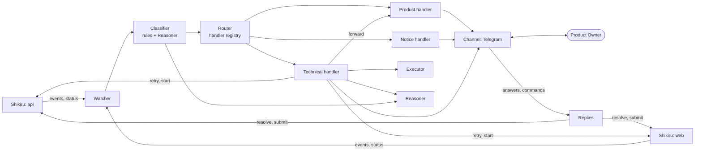

# Shikiri-yaku: design

Status: current design. No code exists yet. It builds on what [Shikiru](https://github.com/ferrum-code-dev/shikiru) provides today: its `README.md`, `docs/design.md` and the MCP server. The implementation plan and the assessment are in [plan.md](plan.md).

## 1. Idea

Shikiru runs the development: one engine per repository, with Leader and Implementer agents, review and integration. When it cannot continue on its own it raises an **escalation** and waits for a person. Today that person watches tmux.

Shikiri-yaku (the **Operator**) takes that seat. It watches the escalations and a few other signals of every Shikiru project of a product, sorts each one into a **category**, and hands it to the **handler** for that category. A handler either resolves the escalation itself or forwards it to the Product Owner (PO) through a chat channel (Telegram first). The PO answers with a button or a short reply, and the Operator applies the answer in Shikiru.

The first release has two handlers:

* **Technical**: retries, waits for quota resets, restarts engines, and, after the PO approves, runs a command such as installing a missing tool. Whatever it cannot fix it forwards.
* **Product**: forwards the escalation to the PO.

Everything else the Operator might do later (taking routine decisions, writing briefs from goals, digests, acceptance notes, more repair actions) is added as a new rule, handler, action or channel. The core does not change ([§12](#12-extensions)).

The Operator exists to remove idle time: work waiting for a person who is not watching, and problems a person would have fixed with one command. Its success is measured by PO wait time and by the share of signals handled without the PO ([§14](#14-proving-it-works)).

## 2. Principles

1. **Shikiru is the source of truth.** Tasks, escalations, their state and history live in Shikiru and are read and changed through its MCP server only. The Operator keeps no copy of the backlog and never touches Shikiru's database.
2. **A small fixed core, growth by extension.** Watching, sorting, routing, replying and journaling are the core. Categories, handlers, actions, reasoner jobs and channels are registered extensions.
3. **Every route ends at the PO.** An unknown signal, an unsure classification, a failed or exhausted handler, or a model that is down all mean *forward to the PO*. Nothing is dropped, and a new extension can never do worse than plain forwarding.
4. **Agents propose, code acts.** The Operator's reasoning agent runs with tools disabled and returns typed data. Only plain code runs commands, and only after the PO has approved the exact command.
5. **Journal before acting, check after.** Every effect (a Shikiru command, a host command, a message) is recorded before it happens, and success is checked by observation, not assumed.
6. **No model is needed to stay useful.** Watching, rule-based sorting, forwarding and replies are plain code. With every model down the Operator still forwards everything.
7. **Nothing of the Operator is stored in the managed repositories,** just as Shikiru keeps its own state out of them.
8. **A gap in Shikiru is a Shikiru requirement,** not an Operator workaround, applied with judgment ([§11](#11-shikiru-what-is-used-what-is-needed)).

## 3. Architecture



One Python process with one asyncio loop, one SQLite journal, one TOML config and the OS service manager. Modules, not services:

| Module | Responsibility | Uses a model? |
|---|---|---|
| **Watcher** | One supervised `shikiru --project P mcp` link per project; durable event cursor; engine liveness; turns events into signals ([§4](#4-signals)) | No |
| **Classifier** | Assigns a category by an ordered rule table; asks the Reasoner only for `decision_required` ([§5](#5-classification)) | Only for `decision_required` |
| **Router** | Handler registry; dispatches by category; turns every failure into a forward; wakes deferred signals; loop guard ([§6](#6-handlers)) | No |
| **Handlers** | Product, Technical and Notice in the first release | Technical: through the Reasoner |
| **Reasoner** | Prompts and schemas for its jobs; one adapter that calls an agent CLI headless with tools disabled ([§8](#8-reasoner)) | Yes |
| **Executor** | Runs approved commands and checks; collects host facts ([§6.3](#63-run-an-approved-command)) | No |
| **Channel** | Adapter interface and the Telegram adapter; outbox; inbound dedupe and sender allow-list ([§7](#7-the-po-channel)) | No |
| **Replies** | Maps button taps, replies and commands to Shikiru commands | No |
| **Journal** | SQLite store ([§9](#9-journal)) | No |

**Why a separate service, not a plugin in an agent session.** Watching, pending questions and message delivery must keep working when an agent runs out of quota, changes or crashes.

### 3.1 One instance per product

A product consists of one or more **components**; each component is one Shikiru project (one repository). One Operator instance serves one product: a directory with `yaku.toml` and `journal.db`, a service unit named after the product, and one chat bot. Several products mean several instances. There is no registry of products.

* **A bot per product.** Telegram allows one long-polling consumer per bot token, and the chat itself shows the PO which product is speaking.
* **Shared on the host:** a lock for running approved commands, so two instances never change the host at the same time, and a claim file per repository, so two instances never watch the same Shikiru project.

## 4. Signals

A **signal** is one thing that may need attention. All signals have the same shape, so classification and routing do not care where they came from:

| Field | Meaning |
|---|---|
| `id` | Stable identity, for example `api:ev-812` or `api:engine-down:2026-10-26T10:00` |
| `project`, `task_id`, `escalation_id` | Where it happened, when known |
| `kind` | `escalation`, `engine_down`, `engine_fault`, `task_done`, `quota_blocked`, `quota_cleared` |
| `reason` | The escalation `reason` from Shikiru, or the stop reason of an engine |
| `text` | The escalation headline and question, or the event message |
| `evidence` | A pointer, not a copy: the escalation packet path, the task id |

**Sources.**

* **Shikiru events.** The Watcher long-polls `wait_for_events(since_id)` per project. `escalation`, `task_done`, `engine_fault`, `quota_blocked`, `quota_cleared` and `engine_stopped` become signals; the rest is ignored. The cursor advance and the signal rows commit in one transaction, so a crash replays at most one batch, and signals are deduplicated by `id`.
* **Engine liveness.** A crashed or killed engine raises no escalation. The Watcher reads `status.engine_up` every minute. An engine that is down after a start, with no `engine_stopped` event since, crashed: that is an `engine_down` signal. An `engine_stopped` event without a reason is a deliberate stop and is respected. One with a reason is a fault stop and becomes an `engine_fault` signal.
* **Event gap.** If the cursor falls behind Shikiru's retention, the Watcher rebuilds open signals from `list_escalations` and `status`.

PO messages are not signals. They go through Replies ([§7](#7-the-po-channel)).

## 5. Classification

A **category** names who should deal with a signal. Categories are an open set; the first release has three:

| Category | Meaning | Handler |
|---|---|---|
| `product` | Needs the PO: a product choice, a delivery decision, or anything unsure | Product |
| `technical` | A problem of the machine or the workflow that code may fix | Technical |
| `notice` | Information, nothing to decide | Notice |

**Rules.** An ordered table, first match wins, defaults below, each overridable in `yaku.toml`. Every Shikiru signal except `decision_required` is sorted by its typed `reason` or `kind`, at no token cost.

| Signal | Category | Why |
|---|---|---|
| `decision_required` | Reasoner decides | Only the text says whether it is a product question or a technical one |
| `iterations_exhausted` | `product` | Leader and Implementer disagree; options include accepting the work as it stands |
| `pr_closed`, `dependency_cancelled` | `product` | Someone chose to stop this work |
| `integration_conflict`, `integration_blocked` | `technical` | A retry is Shikiru's own recommended option |
| `agent_error`, `agent_stuck`, `agent_protocol` | `technical` | Often short-lived |
| `quota_exhausted`, `ladder_exhausted` | `technical` | Waiting for a reset is the usual answer |
| `agent_auth` | `technical` | Recognized, but a login is interactive, so the handler forwards it with instructions |
| `uncommitted_work`, `off_task_branch` | `technical` | Recognized, but work could be lost, so the handler forwards it |
| `engine_error`, `engine_down`, `engine_fault` | `technical` | Restart, then forward |
| `task_done`, `quota_blocked`, `quota_cleared` | `notice` | Information |
| anything else | `product` | Principle 3 |

**`decision_required`.** The asking agent's question and options are text. The Reasoner's `classify` job ([§8](#8-reasoner)) reads the question, the options and the reason, and returns a category, for `technical` a **kind** (`missing_tool` in the first release, otherwise `other`), and a confidence. Below the threshold (default 0.8), on a model failure, or on a timeout, the category is `product`. A wrong label is cheap by design: the technical handler forwards whatever it cannot fix, and it never acts on the host without the PO's approval. Every label is logged with the signal so misroutes can be measured ([§14](#14-proving-it-works)). If labels prove unreliable, a typed category set by the asking agent becomes a Shikiru requirement.

**Extending.** A new category is a rule (or a new value the Reasoner may return) plus a handler registered for it, for example `access` routed to a technical contact, or `spend` for metered usage.

## 6. Handlers

A handler takes one signal and returns one **outcome**:

```python
class Handler(Protocol):
    category: str
    async def handle(self, signal: Signal, ctx: Context) -> Outcome: ...

Outcome = Resolved(note) | Forward(note) | WaitUntil(time, note)
```

* `Resolved`: the handler applied a fix in Shikiru; the signal closes.
* `Forward`: the signal goes to the product handler, with the note saying what was tried and why it stopped.
* `WaitUntil`: the signal is parked with a wake-up time and dispatched again then.

`Context` gives the handler the Shikiru client of the project, the Channel, the Reasoner, the Executor and the signal's history in the journal.

**The Router guarantees the fallback.** An exception, a timeout or an unknown category becomes `Forward`. The **loop guard** counts automatic actions per `(project, task, reason)`. Each action has a budget (default: one retry, one engine restart per hour). A spent budget becomes `Forward` with the history, so a fix that does not hold never loops.

### 6.1 Product handler

In the first release it forwards. The message is a template over Shikiru's fields, so it needs no model:

> **Shop · api · T-12 · Decision needed**
> *Export invoices older than 90 days?* The payment provider only keeps 90 days of invoices.
> ★ A. Ship export for new invoices now (history later)
> B. Add a second data source first (delivery moves)
> *What I tried:* nothing, this is a product question.
> [A] [B] [Reply with text] [Cancel task] [Details]

* The question, options, consequences and ★ come from the escalation packet (the agent's question and options, or Shikiru's resolutions with their consequences for other reasons). The note of a forwarding handler is added as *What I tried*.
* **Answers.** An option button resolves the escalation with `answer` and the chosen option's label and consequences as text. An option that needs input asks for a reply first. A free-text reply to the message is sent as the answer. Shikiru's `retry`, `accept` and `cancel` are offered where the escalation allows them. `accept` (integrates the work as it stands) and `cancel` ask for a confirming tap.
* **Reminders.** An unanswered message is reminded after 4 hours, then daily. Silence never approves anything.
* **Later:** answering from the PO's standing principles, taking cheap reversible choices under an autonomy setting, a summary in product language ([§12](#12-extensions)).

### 6.2 Technical handler

The handler picks an **action** by the signal's reason or kind. Actions are a registry too; the first release has these:

| Signal | Action | Outcome |
|---|---|---|
| `agent_error`, `agent_stuck`, `agent_protocol`, `integration_conflict`, `integration_blocked` | **Retry** after a delay (default 10 min), once | `Resolved`; a second escalation of the same reason forwards |
| `quota_exhausted`, `ladder_exhausted` | **Wait** for the reset time from `status.quotas`, then retry. The PO gets a notice with the time | `WaitUntil`; no known reset time forwards |
| `engine_down`, `engine_fault`, `engine_error` | **Restart** with `shikiru start`, confirm `engine_up`, then retry the task if one was escalated | `Resolved`; a second fault within an hour forwards with `shikiru doctor --json` attached |
| `decision_required` with kind `missing_tool` | **Run an approved command** ([§6.3](#63-run-an-approved-command)) | `Resolved` after the check passes; any failure forwards |
| `agent_auth` | Forward with the login instruction for that agent | `Forward` |
| everything else | No action yet | `Forward` |

Product code is never repaired by the Operator. Retrying gives the work back to Shikiru's agents.

### 6.3 Run an approved command

Running a command needs no agent. The Operator runs as the PO's user, so a command the PO approved is the same as one the PO ran. The agent's part is only to prepare it.

```
signal (missing_tool)
  → host facts            code
  → prepare_command       Reasoner: needed? command, check, risk
  → check before          code: if the check already passes, the tool is there
  → approval              PO taps Install or Decline
  → run                   code, under the host lock
  → check after           code
  → resolve               answer "installed X 1.2" (or retry), so the task continues
```

1. **Facts, not guesses.** Code collects the OS, which package managers exist (`brew`, `uv`, `npm`, `pipx`, …), PATH, and the versions of tools named in the escalation. The Reasoner gets these with the escalation text and returns: is a host install needed, why, the command, a check command, and risk notes.
2. **Is it really missing?** The Executor runs the check first. If it already passes, the tool is there and the problem is something else: the signal is forwarded with that fact. A missing *project* dependency (one that belongs in the project's manifest) is not a host install either; the Reasoner says so, and the escalation is answered with that finding so the agent fixes the manifest.
3. **The PO approves the exact command.** The message shows what, why, the exact command, the check, and what declining means. Risky patterns are flagged in plain words: piping a download into a shell, `sudo`, deleting files. The approval is bound to that exact text; nothing changes it between the tap and the run. **Decline** forwards the original escalation.
4. **It runs like the PO would run it**: through the user's login shell (`$SHELL -lc`), so PATH and tool setup match the PO's terminal; with no terminal input; with a timeout (default 10 minutes). A password prompt fails fast, and the PO gets the command to run personally. One command runs at a time on the host.
5. **Success means the check passes,** not exit code 0. Output goes to a file and its tail into the message on failure.
6. **Journaled before it runs.** After a restart an interrupted command is never re-run blindly: the check runs first, and if it fails the PO is asked again.

The Executor is general. Other actions (restarting a registered service, clearing a cache, system-wide installs through a privileged helper) reuse it with their own `prepare` job and the same approval ([§12](#12-extensions)).

### 6.4 Notice handler

Turns `task_done`, quota waits and engine restarts into short messages. They are rate-limited (default at most 5 a day; beyond that they are skipped, and `/status` still shows the current state). A daily digest is a later extension.

## 7. The PO channel

**Channel interface.** `send(message) → message_ref`, `edit(message_ref, message)`, and a stream of inbound items (button tap, reply, text, command), each with the sender. An adapter implements it for one platform. The first release has Telegram only; the interface already allows several destinations per instance.

**Telegram adapter.** One bot per instance, long polling, inline buttons, edit in place. Updates are saved before the offset advances. Only allow-listed user ids are served.

**Answers apply once.** Button payloads carry the signal and option (`S41.B`); replies are matched by the message they reply to. Shikiru refuses to resolve an escalation that is no longer open. That makes "first answer wins" Shikiru's guarantee: a later or second answer, from any chat, gets "Already resolved: B at 12:03". After resolving, every copy of the message is edited to its final state and its buttons are removed.

**Commands.**

| Command | Effect |
|---|---|
| `/status` | Per component: engine up or down, running, queued and escalated tasks, quota blocks |
| `/open` | Open escalations and pending approvals, with their buttons again |
| `/goal <component> <text>` | `submit_task` in that component with the text as the request; Shikiru's Leader triages and plans it. The PO gets the task id and later its `task_done` notice |
| `/help` | The list |

Free text that is neither a reply nor a command gets the command list. Reading free text with a model is a later extension.

**Secrets never travel through chat.** A message that looks like a secret is refused and, where the platform allows, deleted.

## 8. Reasoner

A thin module with an interface and one adapter.

| Job | Input | Output (schema-checked) |
|---|---|---|
| `classify` | Escalation reason, question and options | `category`, `kind`, `confidence`, one-line reason |
| `prepare_command` | Escalation text and host facts | `needed`, `why`, `command`, `check`, `risk` |

* **Adapter.** One agent CLI run headless (for example `claude -p` with a JSON schema), **tools disabled**, an input cap and a timeout. With tools it could change the host itself and bypass approval. Another agent is another adapter.
* **No ladder, no quota logic.** Any failure (quota, login, timeout, invalid output) means `Forward`. That is the whole fallback, so the Operator needs no agent runtime.
* **Untrusted text in, data out.** Escalation and log text is evidence, never an instruction. The output is validated, and a command still needs the PO's approval.
* **Usage** is logged per call in the journal when the CLI reports it. It is not part of Shikiru's usage ledger; the calls are few and cheap.

New jobs (writing briefs, reading free text, summaries) are added here with their schemas.

## 9. Journal

One SQLite file (WAL), written only by the Operator, backed up nightly.

| Table | Contents | Why it must survive a restart |
|---|---|---|
| `cursors` | Last event id per project | Resume without losing or replaying events |
| `signals` | Identity, category and who set it (rule or Reasoner, with confidence), handler, outcome, notes, wake-up time, automatic-action counts | Deferred work, the loop guard, misroute measures |
| `messages` | Outbound messages per destination with platform ids and delivery state; inbound items for dedupe | Edits, reminders, no double handling |
| `runs` | Approved commands: text, approver, state (`approved → running → done | failed`), check results, output path | Never re-run blindly |
| `ops` | Shikiru commands the Operator issued (resolve, retry, start, submit) with their key and state | Safe restart |

Not stored: tasks, escalation packets, logs, usage of agents. They stay in Shikiru and are read on demand. Retention: closed signals and delivered messages 90 days.

## 10. Restarts and failures

On start the Operator takes its instance lock, then:

1. **Ops.** A `resolve` that may not have been applied is issued again: Shikiru refuses it if the escalation is already resolved, and the recorded resolution is compared. A `submit` is issued again with the same idempotency key ([S1](#11-shikiru-what-is-used-what-is-needed)). A `start` is checked against `status.engine_up`.
2. **Runs.** An interrupted command is never re-run: its check decides, and if the check fails the PO is asked again.
3. **Signals.** Parked signals whose wake-up time has passed are dispatched. Open forwarded messages are re-sent only if their delivery was not confirmed, with their stable reference (`S41`), so a duplicate is recognizable.
4. **Engines.** The liveness rule of [§4](#4-signals) runs at once.

**Other failures.** A broken MCP link is restarted with backoff, and the PO is told if a project stays unreachable for 10 minutes. With the Reasoner down everything that needs it is forwarded. The service manager restarts the Operator; an optional external heartbeat URL covers the case in which it cannot start and so cannot report.

## 11. Shikiru: what is used, what is needed

**Used as it is** (verified in Shikiru's code):

| Capability | Used for |
|---|---|
| `wait_for_events`, `status` (`engine_up`, quotas), `list_escalations`, `get_escalation` (packet with the agent's question and options), `list_tasks`, `get_task` | Signals, messages, `/status` |
| `resolve_escalation` with `answer`, `retry`, `accept`, `cancel`; refusal when the escalation is no longer open | Applying answers exactly once |
| `retry_task`, `send_message`, `submit_task` | Technical actions, `/goal` |
| Typed escalation `reason`; `engine_stopped` with a reason only on a fault stop | Rule classification, the liveness rule |
| CLI `shikiru start`, `shikiru doctor --json` | Engine restart and diagnostics |

**Required.**

| # | Requirement | Why |
|---|---|---|
| **S1** | An optional idempotency `key` on `submit_task`: a repeated key returns the original task id | A restart between submitting and journaling would otherwise create a duplicate task. Small |

**Candidates, each added only when its trigger appears:** a typed category on agent escalations (labels from text prove unreliable); a summary in product language on escalations (the PO finds the raw questions hard to answer); filtering by task family (goal tracking across components is built); a contract version in `status` (the first incompatible Shikiru change).

## 12. Extensions

Each item below is one of: a rule, a handler, an action, a Reasoner job, a channel adapter, or a Shikiru candidate. None changes the core.

| Extension | Kind | What it adds | Trigger |
|---|---|---|---|
| Autonomy setting | Wrapper around handlers | Approve allow-listed commands or take cheap reversible product choices without asking, announced with an undo; promoted after repeated unchanged approvals, demoted at once on a veto | The PO approves the same kind of thing repeatedly |
| Product charter | Product handler + Reasoner job | Questions the PO's written principles already answer are answered from them | Repeated questions of the same kind |
| Goal intake | Reasoner job + handler | Free-text goals turned into briefs per component, routed by a short description of each component kept by Shikiru, with cross-component order | `/goal <component>` proves too manual |
| Daily digest and acceptance note | Notice handler | One message a day; a note on finished work against its acceptance criteria | Notices become noise |
| System-wide actions | Technical actions | A privileged helper with typed verbs (`pkg-install`, `service-restart`) behind one sudoers entry | First install that needs `sudo` |
| More repair actions | Technical actions | Disk clean-up, service restart, diagnosis of unknown failures | Recurring forwarded technical signals of one kind |
| Technical contact | Category `access` + routing | Access and login requests go to a second person | A second person exists |
| Second channel | Channel adapter | Another chat platform; answers already apply once | A real need |
| Release tracking | Action + notice | A release command and probe; reports say "released" only with it | The PO wants releases tracked |

Each gets its own short design when its trigger appears, written against the signals the first release has collected.

## 13. The nine scenarios

| # | Scenario | First release | Later |
|---|---|---|---|
| 1 | The PO describes a goal | `/goal <component> <text>`; Shikiru's Leader triages and plans; done notices | Goal intake extension |
| 2 | Development hits a technical problem | Retry, quota wait, engine restart; missing tool installed after approval; the rest forwarded with what was tried | More actions |
| 3 | The first repair does not work | Loop guard: one automatic action per cause, then forward with the history; a failed check forwards with the output | Further strategies per action |
| 4 | A real product decision | Forwarded with the agent's options and ★; one tap applies it | Charter answers, autonomy |
| 5 | Access or authority is missing | Login problems forwarded with instructions; `sudo` steps forwarded as a command for the PO | Technical contact, privileged helper |
| 6 | The PO wants to know what is happening | `/status`, `/open`, done notices | Digest, acceptance notes |
| 7 | An agent becomes unavailable | Shikiru's own ladders first; quota escalations wait for the reset; the Operator's Reasoner down means forward | — |
| 8 | The computer or the Operator restarts | Cursors, `ops`, `runs`, the liveness rule ([§10](#10-restarts-and-failures)) | — |
| 9 | Several channels | Interface supports several destinations; Shikiru applies only the first answer | Second adapter |

## 14. Proving it works

**Drills**, against Shikiru with its fake agent and against two small real projects:

* A missing tool: approve, install, check, task continues. The same with Decline, and with a tool that is already there.
* A transient agent error: one retry, then a forward when it repeats.
* Quota exhaustion: the wait, the notice, the retry at reset.
* Kill an engine; kill the Operator mid-run of a command, mid-resolve and mid-send; reboot the host.
* Two answers to the same question, from two chats.
* The Reasoner unavailable: everything is forwarded, nothing is lost.

**Measures,** always on, from journal timestamps:

| Measure | Why |
|---|---|
| **PO wait time**: escalation raised to resolved, and the share spent waiting for the PO | The idle time the Operator exists to remove |
| **Handled without the PO**, per category and action | Shows which extensions are worth building next |
| **Escalation mix**: count per reason and per Reasoner label | Real data to decide the next handlers ([plan.md](plan.md)) |
| **Misroutes**: every message about a signal the Reasoner labeled carries a *Wrong category* button | Whether text classification is good enough |
| **Approved commands**: approved, declined, checks failed | Whether the install path earns its keep |

## 15. Trade-offs and limits

1. **Classification from text, not a typed field.** No Shikiru change and works with every agent. The cost is a model call per `decision_required` and possible misroutes; bounded by "unsure means product", by approval before any host change, and by measuring misroutes.
2. **The Operator's own Reasoner, outside Shikiru.** A few cheap calls with no ladder, because failure simply forwards. Their usage is logged by the Operator, not in Shikiru's ledger.
3. **Forward by default.** The first release saves the PO the technical interruptions it can fix and makes every other one answerable from the phone. Product questions still reach the PO, in Shikiru's own wording.
4. **The PO approves host commands.** Safe and simple, but it relies on the PO reading the command. Risky patterns are flagged; an allow-list with automatic approval is a later extension.
5. **No cross-component planning yet.** The PO names the component in `/goal`. Splitting one goal over several components is an extension.
6. **One host, one channel.** Not highly available. A lost Telegram acknowledgement can produce a duplicate message, which carries its reference.
